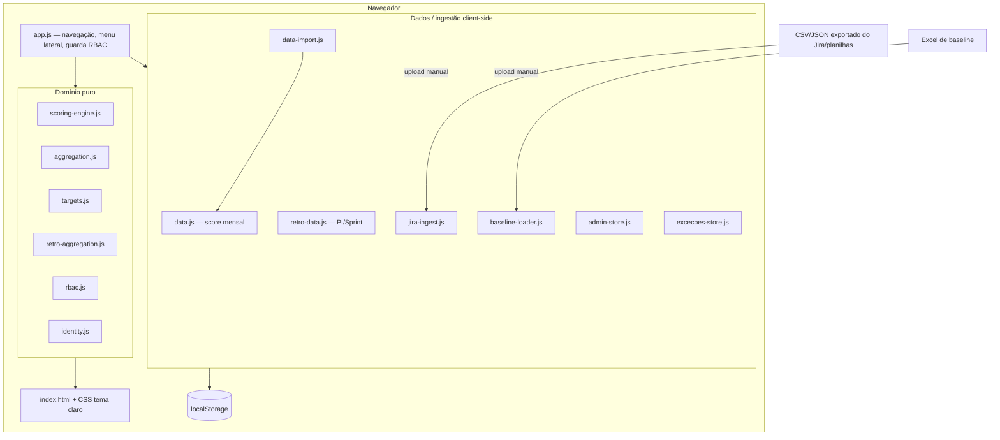
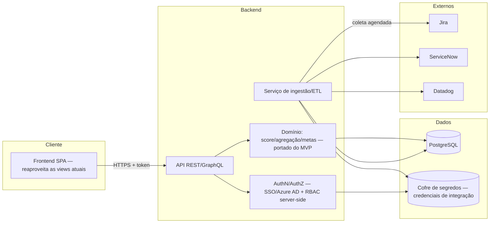

# Documento de Arquitetura — Plataforma de Engenharia de Performance (PEP)

## 1. Propósito

Descreve a arquitetura **atual** (MVP estático client-side) e a arquitetura-**alvo** de produção (frontend + backend + banco + integrações), além do plano de migração entre elas. Complementa `design.md` (regras de domínio) e `data-model.md` (modelo de dados).

## 2. Princípios

- **Domínio puro e testável:** o núcleo (motor de score, agregações, metas, RBAC) é composto de funções puras, validadas por property-based testing (fast-check). Isso se mantém na migração.
- **Fonte única por responsabilidade:** regras de score em `scoring-engine.js`; permissões em `rbac.js`; identidade de jornada/squad em `identity.js`.
- **Nega por omissão** no controle de acesso.
- **Separação de módulos:** Score e Retrospectiva de PI são independentes; integrações não contaminam o domínio.

## 3. Arquitetura ATUAL (MVP — Opção B: estático, sem backend)

Aplicação 100% client-side (HTML/CSS/JS), carregada por `<script>`, sem build. Persistência em `localStorage` (fallback em memória). Chart.js e SheetJS via CDN.

**Limitações estruturais (por design):** dados por navegador (sem compartilhamento/backup), sem autenticação real, coleta de dados manual, sem concorrência.

## 4. Arquitetura-ALVO (produção)

Introduz backend, banco relacional, autenticação corporativa (SSO) e integrações automáticas, **reaproveitando o domínio puro** (o mesmo motor de cálculo roda no backend ou é portado).

### Componentes-alvo
- **Frontend SPA:** reusa as views existentes (Score, Retro, gestão); troca `localStorage` por chamadas à API; o RBAC client-side passa a espelhar o RBAC do servidor (que é a autoridade).
- **API:** expõe os dados de domínio e as operações de gestão/exceção; aplica permissões no servidor.
- **AuthN/AuthZ:** login via SSO corporativo (Azure AD, dado o contexto Cogna); a matriz de permissões (`rbac.PERMISSIONS`) vira dados no banco (`Perfil`/`Permissao`).
- **ETL/Ingestão:** coleta agendada do Jira (itens → indicadores por Sprint), ServiceNow (incidentes/SLA) e Datadog (disponibilidade). Substitui os uploads manuais.
- **Banco (PostgreSQL):** persistência central (ver `data-model.md` e `database-ddl.sql`).
- **Cofre de segredos:** credenciais de integração ficam fora do banco de domínio (regra já aplicada no MVP, que descarta campos sensíveis).

## 5. Mapeamento MVP → Produção

| Hoje (MVP) | Produção |
|---|---|
| `localStorage` | PostgreSQL via API |
| Upload manual de CSV/JSON do Jira | ETL com coleta agendada do Jira |
| Upload de Excel de baseline | Importação via API (mantém upload como fallback) |
| `admin-store.js` (coleções) | Tabelas + endpoints CRUD |
| `excecoes-store.js` | Tabela `Excecao` + workflow no servidor |
| Perfil client-side (simulação) | SSO + RBAC server-side (autoridade) |
| `data-import.js`/`jira-ingest.js` | Pipeline de ETL/validação no backend |
| Domínio puro (score/agregação/metas) | Mesmo domínio portado para o backend |

## 6. Plano de migração (incremental)

1. **Extrair o domínio** em um pacote reutilizável (score/agregação/metas/RBAC) — já é puro, facilita.
2. **Subir o banco** a partir do `database-ddl.sql`; seed inicial pelos CSVs atuais (o round-trip já existe).
3. **API mínima** de leitura (dashboards) + autenticação SSO.
4. **Migrar escrita** (gestão, exceções) para a API; manter import/export como ponte.
5. **ETL do Jira** (depois ServiceNow/Datadog) substituindo o upload manual.
6. **Promover o RBAC** para o servidor; o client passa a refletir, não a decidir.

## 7. Decisões transversais

- **Segurança:** HTTPS obrigatório; segredos em cofre; nega por omissão; auditoria (histórico de exceções já existe no modelo).
- **Observabilidade:** logs de ETL e de acesso; métricas de uso por perfil.
- **Compatibilidade:** manter import/export CSV/JSON como contrato estável entre MVP e produção.

## 8. Riscos e mitigação

| Risco | Mitigação |
|---|---|
| Divergência de identidade (nomes Jira × plataforma) | `identity.js` + mapeamento de integração; reconciliação já implementada |
| Perda de dados no MVP (localStorage) | Exportação/backup regular até haver banco |
| Credenciais expostas | Cofre de segredos; nunca no banco de domínio nem no cliente |
| Regra de score divergir da planilha | Oráculo de equivalência (property-based testing) mantido na migração |

## 9. Documentos relacionados
- `requirements.md` — requisitos (EARS).
- `design.md` — regras de domínio e propriedades de correção.
- `data-model.md` — modelo lógico/ER.
- `database-ddl.sql` — DDL físico (PostgreSQL).
- `adr/` — registros de decisão de arquitetura.
