# Modelo de Dados — Plataforma de Engenharia de Performance (PEP)

## Objetivo

Este documento descreve o **modelo de dados proposto** para a fase de produção da PEP, derivado do que a plataforma já modela hoje em `localStorage` (schemas de `admin-store.js`, estruturas de `data.js`/`retro-data.js` e o store de exceções). Hoje **não há banco de dados**: a persistência é client-side por decisão (app estático, Opção B). Este modelo é o passo de transição para um backend com banco relacional.

> Estado atual: sem banco. Persistência em `localStorage` (fallback em memória). Este documento NÃO altera o código; é o desenho de referência para a fase de produção.

## Convenções

- Chaves primárias: `id` (UUID/string). Já existe geração de `id` por coleção no `admin-store.js`.
- Nomes de Jornada/Squad seguem a **identidade canônica** (`identity.js`): a normalização (sem acento/caixa/espaço) é a base para unicidade lógica.
- Campos monetários/numéricos de score usam `DECIMAL` para evitar erro de ponto flutuante.
- Segurança: a entidade de Integração **não** armazena credenciais (token/senha/apiKey) — regra já aplicada no `admin-store.js` (`SENSITIVE_KEYS`). Credenciais ficam em um cofre de segredos do backend, fora do banco de domínio.

## Entidades (derivadas do código atual)

### Organização
- **Tribo (Jornada)** — `id`, `nome`, `nome_canonico` (único).
- **Squad** — `id`, `tribo_id` (FK), `nome`, `nome_canonico` (único por tribo). Origem: `tribosSquads` + `identity.js`.

### Pessoas e acesso
- **Usuario** — `id`, `nome`, `email` (único), `perfil_id` (FK). Origem: `admin-store.usuarios`.
- **Perfil** — `id`, `nome` (admin, dm, tm, gpm, tl), rótulo. Origem: `admin-store.perfis` + `rbac.js`.
- **Permissao** — `id`, `screen_id` (tela), `label`. Catálogo de telas de `rbac.SCREENS`.
- **PerfilPermissao** — `perfil_id` (FK), `permissao_id` (FK). Tabela associativa N:N (a matriz do `rbac.PERMISSIONS`). Inclui também as permissões de ação (`excecao:solicitar`, `excecao:aprovar`).

### Ciclo e tempo
- **PI** — `id`, `codigo` (ex.: "PI 3/26"), `ano`, `numero`.
- **Sprint** — `id`, `pi_id` (FK), `codigo` (ex.: "SP 26.3.1"), `ordem`.

### Score de Performance (modelo mensal — `data.js`)
- **Metrica** — `id`, `chave` (planejadoVsRealizado, cycleTimeDev, …), `nome`, `categoria` (processos/praticas/produto/pessoas), `peso_max`, `escala`, `direcao`. Catálogo das 12 métricas (`scoring-engine.METRIC_RULES`).
- **ScoreMensal** — `id`, `squad_id` (FK), `ano`, `mes` (1–12). Um registro por squad/mês.
- **ScoreMetricaValor** — `id`, `score_mensal_id` (FK), `metrica_id` (FK), `valor`, `pontos`, `faixa`. Valor de cada métrica no mês (origem: `metrics{}` de `data.js`).
- **Meta (KPI)** — `id`, `tribo_id`/`squad_id` (FK), `nome`, `meta` (DECIMAL), `meta_pct`, `partida`. Origem: `admin-store.kpis` + `targets.js` (Partida dez/25, Meta%).

### Retrospectiva de PI (modelo por PI/Sprint/Squad — `retro-data.js`)
- **ItemJira** — `id`, `chave` (única), `tipo_item`, `status`, `squad_id` (FK), `pi_id` (FK), `sprint_id` (FK), `story_points`, datas de fluxo (`criado_em`, `inicio_dev`, `fim_dev`, `homologado_em`, `implantado_em`, `resolvido_em`). Origem: extração do Jira (`jira-ingest.js`).
- **PontosTrabalhados** — `id`, `pi_id`, `sprint_id`, `squad_id` (hoje = jornada; ver nota), `sustentacao`, `entrega_valor`, `total`, `planejado`, `real`, `pi_planning`, `velocidade`. Derivado por sprint. `planejado`/`pi_planning` vêm do **baseline** do PI (SP planejados por jornada); `real`/`velocidade`, da Velocity. No seed atual a granularidade é por **jornada** (não há quebra por squad nesta fonte).
- **CycleTime** — `id`, `pi_id`, `squad_id`, `ideacao`, `desenvolvimento`, `homologacao`, `implantacao`.
- **LeadTime** — `id`, `pi_id`, `squad_id`, `tipo_item`, `dias`.
- **Produtividade** — `id`, `squad_id` (hoje = jornada; ver nota), `pi_id`, `valor` (pontos/integrante). No seed atual a medição é por **jornada**; o filtro de Squad resolve a jornada do squad.
- **SituacaoEpico** — `id`, `pi_id`, `squad_id`, `chave`, `situacao` (atrasado/replanejado/em-risco/em-dia/finalizado/despriorizado), `origem` (baseline/mudanca-escopo).
- **Debito** — `id`, `pi_id`, `squad_id`, `backlog_qtde`, `planejado_sp`, `real_sp`, `entregue_sp`, `pendente_sp`, `cancelado_sp` (+ equivalentes em quantidade).
- **Sustentacao** — `id`, `pi_id`, `squad_id`, `realizado`, `planejado`.
- **CargaTrabalho** — `id`, `pi_id`, `tipo_item`, `pontos`, `qtde_itens`, `pontuacao_media`.
- **AlteracaoPlano** — `id`, `pi_id`, `dimensao` (epicos/historias/pontos), `baseline`, `plan_pi_planning`, `mudanca_escopo`, `cancelado`, `transbordo_aceito`, `transbordo_pendentes`.
- **Impedimento** — `id`, `pi_id`, `sprint_id` (nullable), `quantidade`, `localizacao`, `tempo_remocao`.
- **BaselinePI** — `id`, `pi_id` (FK), `squad_id` (FK, nullable), `chave_epico`, `situacao_planejada`. Origem: `baseline-loader.js`.

### OKRs e governança
- **OKR** — `id`, `tribo_id`/`squad_id` (FK), `objetivo`, `key_result`, `progresso` (DECIMAL). Origem: `admin-store.okrs`.
- **Excecao** — `id`, `squad_id` (FK), `metrica_id`/`indicador`, `justificativa`, `periodo`, `status` (pendente/aprovada/rejeitada), `solicitante_id` (FK Usuario), `aprovador_id` (FK, nullable), `motivo_rejeicao`, `criado_em`, `decidido_em`. Origem: `excecoes-store.js`.
- **ExcecaoHistorico** — `id`, `excecao_id` (FK), `estado`, `ator_id` (FK), `data`. Rastreabilidade do fluxo de aprovação (Req 30.10).

### Configuração
- **Comunicacao** — `id`, `canal`, `destino`, `ativo`. Origem: `admin-store.comunicacao`.
- **Integracao** — `id`, `sistema`, `projeto_jira`, `jornada`, `squad` (mapeamento Jira→Jornada/Squad; SEM credenciais). Origem: `admin-store.integracao` + `jira-mapping.js`.

## Diagrama de Entidade-Relacionamento (ER)

```mermaid
erDiagram
    TRIBO ||--o{ SQUAD : contem
    PERFIL ||--o{ USUARIO : classifica
    PERFIL ||--o{ PERFIL_PERMISSAO : possui
    PERMISSAO ||--o{ PERFIL_PERMISSAO : concede

    PI ||--o{ SPRINT : contem

    SQUAD ||--o{ SCORE_MENSAL : avaliado_em
    SCORE_MENSAL ||--o{ SCORE_METRICA_VALOR : detalha
    METRICA ||--o{ SCORE_METRICA_VALOR : referencia
    SQUAD ||--o{ META_KPI : define
    TRIBO ||--o{ META_KPI : define

    SQUAD ||--o{ ITEM_JIRA : pertence
    PI ||--o{ ITEM_JIRA : no_pi
    SPRINT ||--o{ ITEM_JIRA : na_sprint

    PI ||--o{ PONTOS_TRABALHADOS : agrega
    SQUAD ||--o{ PONTOS_TRABALHADOS : por_squad
    PI ||--o{ CYCLE_TIME : agrega
    PI ||--o{ LEAD_TIME : agrega
    PI ||--o{ PRODUTIVIDADE : agrega
    PI ||--o{ SITUACAO_EPICO : agrega
    PI ||--o{ DEBITO : agrega
    PI ||--o{ SUSTENTACAO : agrega
    PI ||--o{ CARGA_TRABALHO : agrega
    PI ||--o{ ALTERACAO_PLANO : agrega
    PI ||--o{ IMPEDIMENTO : agrega
    PI ||--o{ BASELINE_PI : referencia

    TRIBO ||--o{ OKR : define
    SQUAD ||--o{ OKR : define

    SQUAD ||--o{ EXCECAO : afeta
    USUARIO ||--o{ EXCECAO : solicita
    METRICA ||--o{ EXCECAO : incide
    EXCECAO ||--o{ EXCECAO_HISTORICO : registra

    TRIBO {
      string id PK
      string nome
      string nome_canonico UK
    }
    SQUAD {
      string id PK
      string tribo_id FK
      string nome
      string nome_canonico
    }
    USUARIO {
      string id PK
      string nome
      string email UK
      string perfil_id FK
    }
    PERFIL {
      string id PK
      string nome
    }
    PERMISSAO {
      string id PK
      string screen_id
      string label
    }
    PERFIL_PERMISSAO {
      string perfil_id FK
      string permissao_id FK
    }
    PI {
      string id PK
      string codigo
      int ano
      int numero
    }
    SPRINT {
      string id PK
      string pi_id FK
      string codigo
      int ordem
    }
    METRICA {
      string id PK
      string chave
      string categoria
      decimal peso_max
    }
    SCORE_MENSAL {
      string id PK
      string squad_id FK
      int ano
      int mes
    }
    SCORE_METRICA_VALOR {
      string id PK
      string score_mensal_id FK
      string metrica_id FK
      decimal valor
      decimal pontos
      string faixa
    }
    META_KPI {
      string id PK
      string tribo_id FK
      string squad_id FK
      string nome
      decimal meta
      decimal meta_pct
      decimal partida
    }
    ITEM_JIRA {
      string id PK
      string chave UK
      string tipo_item
      string status
      string squad_id FK
      string pi_id FK
      string sprint_id FK
      decimal story_points
    }
    OKR {
      string id PK
      string tribo_id FK
      string squad_id FK
      string objetivo
      string key_result
      decimal progresso
    }
    EXCECAO {
      string id PK
      string squad_id FK
      string metrica_id FK
      string status
      string solicitante_id FK
      string aprovador_id FK
      string justificativa
    }
    EXCECAO_HISTORICO {
      string id PK
      string excecao_id FK
      string estado
      string ator_id FK
      datetime data
    }
    BASELINE_PI {
      string id PK
      string pi_id FK
      string squad_id FK
      string chave_epico
      string situacao_planejada
    }
```

## Relacionamentos-chave

- **Tribo 1—N Squad**; **Squad** é o pivô central: ligado a Score, Retro, OKR e Exceção.
- **PI 1—N Sprint**; itens e indicadores de Retro referenciam PI (e Sprint quando aplicável).
- **Perfil N—N Permissão** via `PerfilPermissao` — a matriz do RBAC vira dados (passível de edição na Gestão de Perfis, Req 31.2).
- **Excecao** referencia **Usuario** (solicitante e aprovador) e tem **ExcecaoHistorico** para o fluxo TM→DM (Req 30).
- **ScoreMensal 1—N ScoreMetricaValor** (12 por mês) referenciando o catálogo **Metrica**.

## Notas de migração (localStorage → banco)

1. As coleções de `admin-store.js` mapeiam 1:1 para tabelas (`usuarios`, `perfis`, `tribosSquads`→Tribo+Squad, `kpis`→MetaKPI, `okrs`, `comunicacao`, `integracao`).
2. Os datasets de domínio (`data.js`, `retro-data.js`) tornam-se tabelas de fato (ScoreMensal/…, ItemJira e derivados). O import CSV/JSON atual vira o pipeline de carga (ETL) para o banco.
3. O round-trip CSV/JSON já existente (`toCSV`/`fromCSV`) serve como formato de import/export e seed inicial do banco.
4. A identidade canônica (`identity.js`) define as **chaves de unicidade** de Tribo/Squad — essencial para integridade referencial. A comparação de squad na consulta de Retro é **tolerante** (normaliza acento/espaço/caixa + aliases), para reconciliar rótulos do cadastro com os valores das extrações; o modelo de banco deve normalizar esses nomes na carga (ETL) para `squad_id` único.
5. Credenciais de integração NÃO entram neste modelo; ficam em cofre de segredos no backend.
6. **Granularidade por squad:** hoje só a Situação dos Épicos tem `squad` real; Pontos Trabalhados e Produtividade são por **jornada**. Para o banco, manter `squad_id` em todas as tabelas de Retro, porém ciente de que, até a fonte reportar por squad, Pontos/Produtividade são preenchidos no nível da jornada (todos os squads da jornada compartilham o valor). No PI 4/26, `planejado`/`pi_planning` vêm do baseline (`Baseline_Jornadas_26.4.xlsx`).

## Fora de escopo (depende da fase de produção)

- Tecnologia do banco (ex.: PostgreSQL), ORM, migrações versionadas.
- Autenticação/SSO e aplicação de permissões no servidor.
- Auditoria/log de alterações além do histórico de exceções.
- Estratégia de concorrência e backup.
