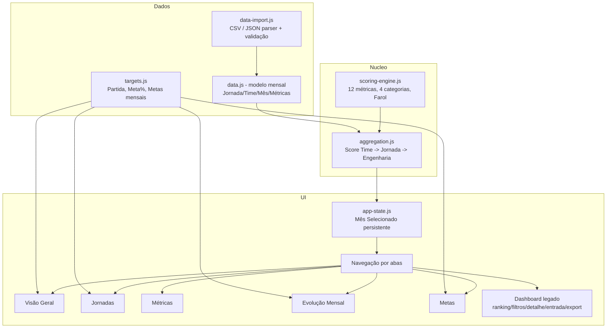
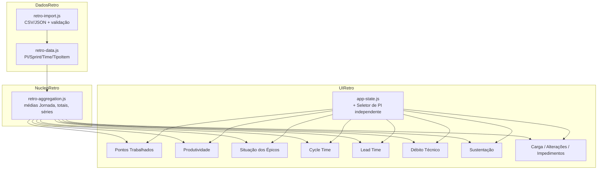
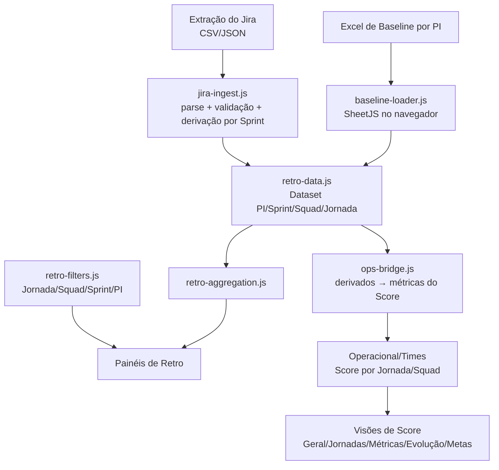

# Design Document

## Overview

Esta feature estende o MVP **PEP — Plataforma de Engenharia de Performance** (aplicação estática HTML/CSS/JS, sem backend, Chart.js via CDN, tema claro via variáveis CSS) em dois eixos:

1. **Reconciliação do Motor de Cálculo** (`scoring-engine.js`) com a fonte da verdade (Pílula de Score de Performance e planilha de Score), corrigindo divergências identificadas no código atual.
2. **Expansão para visões executivas mensais**: cinco novas telas (Visão Geral, Jornadas, Métricas, Evolução mensal, Metas) alimentadas por um **modelo de dados mensal** por Jornada/Time (Jan–Dez), com seletor de mês persistente, cálculo de metas progressivas e Farol de atingimento.

A entrega **preserva** a arquitetura de app estático (sem build, servidor ou instalação), a identidade visual da plataforma e as capacidades existentes (ranking, filtros, detalhamento por métrica, entrada manual, exportação CSV com `;` e UTF-8 BOM).

> Nota de evolução de UI: a plataforma adota **tema claro** como padrão, implementado por variáveis CSS (`:root` em `css/styles.css`). As cores de texto dos gráficos (Chart.js) são lidas dinamicamente dessas variáveis, o que mantém o código preparado para alternância de tema no futuro.

### Divergências corrigidas (código atual → regra oficial)

A análise do `scoring-engine.js` atual revelou os seguintes pontos que divergem da tabela de regras do Requirement 1 e **devem ser corrigidos** (Requirement 1.11):

| # | Item | Código atual (divergente) | Regra oficial (fonte da verdade) |
|---|---|---|---|
| D1 | Teto do score | `MAX_TOTAL_SCORE = 1092` | **1089** |
| D2 | Faixa "Ótima" | `1001–1092` | `acima de 1000` (teto 1089) |
| D3 | Categoria do OKRs | `dimension: 'processos'` | **Produto** (nova categoria, 50 pts) |
| D4 | Categorias/pesos | 3 dimensões (Processos 500, Práticas 450, Pessoas 50) | **4 categorias**: Processos **450**, Práticas 450, Produto 50, Pessoas 50 |
| D5 | Cycle Time Implantação | faixas `<5 superou`, `≤6 total`, `≤8 parcial` | `≥5 não atendeu` · `≥3 e <5 parcial (10→5)` · `≥2 e <3 total (50→30)` · `<2 superou (55)` |
| D6 | Team Health Check | escala 0–1 (`0.7 / 0.8 / 0.95`) | escala **0–10** (`<7 não` · `7–8 parcial 10→20` · `>8 e ≤9,5 total 40→50` · `>9,5 superou 55`) |
| D7 | Topo da interpolação parcial | usa limites como `0.999`, `5.999`, `3.999` | interpolar **proporcionalmente do piso baixo até o valor-topo da faixa**, usando o limite real da faixa |
| D8 | Farol "Na meta" | inexistente no motor | `Atingimento ≥ 99%` tratado como aproximação de 100% |

Essas correções são o núcleo do Requirement 1 e são validadas pela propriedade de equivalência com a planilha (Requirement 1.12).

## Architecture

A aplicação mantém o padrão de **módulos IIFE** em JavaScript puro, carregados por `<script>` no `index.html`, sem bundler. As novas visões executivas são adicionadas como **abas/rotas client-side** sobre a mesma página (SPA leve baseada em troca de seção visível), reutilizando a infra de Chart.js e o tema da plataforma.



### Decisões de arquitetura e justificativas

- **Separação do motor de cálculo da fonte de dados**: o `scoring-engine.js` permanece puro (entrada: valores de métrica; saída: pontuação/faixa), o que torna as correções testáveis por property-based testing isoladamente. (Requirement 1, 1.12)
- **Tabela de regras declarativa**: as faixas das 12 métricas passam a ser descritas por uma **estrutura de dados única** (`METRIC_RULES`), em vez de 12 funções com limites hardcoded divergentes. Uma única função de avaliação (`evaluateMetric`) percorre as faixas. Isso elimina a fonte das divergências D5/D7 e garante que piso/topo/escala venham de um só lugar. (Requirement 1.4, 1.5, 1.11)
- **Modelo mensal normalizado**: os dados passam de snapshot único para registros `(mês, jornada, time, métricas)`, permitindo séries temporais (Evolução) e cálculos de meta por mês. (Requirement 8.1, 8.2)
- **Estado de Mês Selecionado persistente** em `localStorage`, aplicado a todas as visões, sem reset ao navegar. (Requirement 2.5)
- **Importação client-side (CSV/JSON)** sem backend, usando `FileReader`, preservando a natureza estática. (Requirement 8.3, 9.7)
- **Agregação em dois níveis**: Score de Jornada = média dos Times; Score de Engenharia = média das Jornadas. A média é **de Jornadas** (não ponderada por nº de times), conforme glossário. (Requirement 3.1, 4.1)

### Estrutura de arquivos (após a feature)

```
aplicacao/
├── index.html              # + navegação por abas e containers das 5 visões
├── css/
│   └── styles.css          # + estilos das visões (reusa tema da plataforma)
├── js/
│   ├── scoring-engine.js   # CORRIGIDO: 4 categorias, teto 1089, THC 0-10, CT Impl, interpolação, Farol
│   ├── data.js             # modelo mensal (Jan-Dez por jornada/time)
│   ├── data-import.js      # NOVO: parser/validação CSV e JSON
│   ├── targets.js          # NOVO: Partida, Meta%, Meta 2026, Meta do Mês, Atingimento, Farol
│   ├── aggregation.js      # NOVO: agregação Time->Jornada->Engenharia por mês
│   ├── app-state.js        # NOVO: Mês Selecionado persistente + navegação
│   ├── views/
│   │   ├── view-geral.js        # NOVO
│   │   ├── view-jornadas.js     # NOVO
│   │   ├── view-metricas.js     # NOVO
│   │   ├── view-evolucao.js     # NOVO
│   │   └── view-metas.js        # NOVO
│   ├── dashboard.js        # legado preservado (ranking/filtros/detalhe/entrada/export)
│   └── app.js              # init + wiring das abas
└── tests/                  # NOVO: property-based tests (ver Testing Strategy)
```

## Components and Interfaces

### 1. Scoring Engine (reconciliado) — `scoring-engine.js`

Núcleo puro de cálculo. Substitui as 12 funções hardcoded por uma **tabela de regras + avaliador genérico**.

```js
// Categorias (4 Ps)
const CATEGORIES = {
  processos: { id:'processos', name:'Processos', maxScore:450, icon:'⚙️' },
  praticas:  { id:'praticas',  name:'Práticas',  maxScore:450, icon:'🛡️' },
  produto:   { id:'produto',   name:'Produto',   maxScore:50,  icon:'📦' },
  pessoas:   { id:'pessoas',   name:'Pessoas',   maxScore:50,  icon:'👥' }
};

const MAX_TOTAL_SCORE = 1089;      // corrige D1/D2
const BASE_MAX_SCORE  = 1000;      // base sem bônus

// Faixas de performance (Requirement 1.9)
const PERFORMANCE_BANDS = [
  { id:'baixa', name:'Baixa',  min:0,    max:500 },
  { id:'media', name:'Média',  min:501,  max:839 },
  { id:'boa',   name:'Boa',    min:840,  max:1000 },
  { id:'otima', name:'Ótima',  min:1001, max:MAX_TOTAL_SCORE }
];

// Direção: 'higher' (maior melhor) ou 'lower' (menor melhor, Cycle Time)
// bands: ordem de melhor->pior OU pior->melhor; cada faixa define
//   [limite inferior, limite superior) e piso/topo de pontuação.
const METRIC_RULES = {
  planejadoVsRealizado: {
    category:'processos', max:150, direction:'higher', scale:'ratio',
    naoAtendeu:  { lt:0.75 },
    parcial:     { from:0.75, to:1.00, floor:50,  top:120 }, // interpola 50->120
    totalmente:  { eq:1.00, points:150 },
    superou:     { gt:1.00, points:165 }
  },
  cycleTimeDev: {
    category:'processos', max:125, direction:'lower', scale:'days',
    superou:     { lt:3, points:138 },
    totalmente:  { from:3, to:4, floor:125, top:100 }, // menor melhor: 3->125, 4->100
    parcial:     { from:4, to:6, floor:50,  top:10 },
    naoAtendeu:  { gte:6 }
  },
  cycleTimeHomolog: {
    category:'processos', max:50, direction:'lower', scale:'days',
    superou:     { lt:1, points:55 },
    totalmente:  { from:1, to:2, floor:50, top:30 },
    parcial:     { from:2, to:3, floor:10, top:5 },
    naoAtendeu:  { gte:3 }
  },
  cycleTimeImpl: {                                 // corrige D5
    category:'processos', max:50, direction:'lower', scale:'days',
    superou:     { lt:2, points:55 },
    totalmente:  { from:2, to:3, floor:50, top:30 },
    parcial:     { from:3, to:5, floor:10, top:5 },
    naoAtendeu:  { gte:5 }
  },
  freqDeploy: {
    category:'processos', max:75, direction:'category', scale:'category',
    naoAtendeu:  { categoryIn:[0,1] },
    parcial:     { categoryEq:2, points:30 },
    totalmente:  { categoryEq:3, points:75 },
    superou:     { categoryGte:4, points:80 }
  },
  disponibilidade: {
    category:'praticas', max:175, direction:'higher', scale:'ratio',
    naoAtendeu:  { lt:0.97 },
    parcial:     { from:0.97, to:0.99, floor:10,  top:50 },
    totalmente:  { from:0.99, to:0.995, floor:100, top:175 },
    superou:     { gte:0.995, points:193 }
  },
  vulnerabilidade: {
    category:'praticas', max:175, direction:'higher', scale:'ratio',
    naoAtendeu:  { lt:0.75 },
    parcial:     { from:0.75, to:1.00, floor:50, top:120 },
    totalmente:  { eq:1.00, points:175 },
    superou:     { gt:1.00, points:193 }
  },
  slaAlta:  { category:'praticas', max:50, direction:'higher', scale:'ratio', noSuperou:true,
    naoAtendeu:{ lt:0.90 }, parcial:{ from:0.90, to:1.00, floor:5, top:40 }, totalmente:{ eq:1.00, points:50 } },
  slaMedia: { category:'praticas', max:30, direction:'higher', scale:'ratio', noSuperou:true,
    naoAtendeu:{ lt:0.90 }, parcial:{ from:0.90, to:1.00, floor:3, top:25 }, totalmente:{ eq:1.00, points:30 } },
  slaBaixa: { category:'praticas', max:20, direction:'higher', scale:'ratio', noSuperou:true,
    naoAtendeu:{ lt:0.90 }, parcial:{ from:0.90, to:1.00, floor:2, top:15 }, totalmente:{ eq:1.00, points:20 } },
  okrs: {                                          // corrige D3 (categoria Produto)
    category:'produto', max:50, direction:'higher', scale:'ratio',
    naoAtendeu:  { lt:0.60 },
    parcial:     { from:0.60, to:0.80, floor:10, top:25 },
    totalmente:  { from:0.80, to:1.00, floor:40, top:50 },
    superou:     { eq:1.00, points:55 }
  },
  teamHealth: {                                    // corrige D6 (escala 0-10)
    category:'pessoas', max:50, direction:'higher', scale:'thc0a10',
    naoAtendeu:  { lt:7 },
    parcial:     { from:7, to:8, floor:10, top:20, inclusiveTop:true },  // 7..8
    totalmente:  { from:8, to:9.5, floor:40, top:50, exclusiveFrom:true, inclusiveTop:true }, // >8..9,5
    superou:     { gt:9.5, points:55 }
  }
};
```

Interface pública (mantém compatibilidade com o legado onde possível):

```js
ScoringEngine = {
  CATEGORIES, PERFORMANCE_BANDS, MAX_TOTAL_SCORE, BASE_MAX_SCORE, METRIC_RULES,

  // Avaliador genérico de uma métrica
  evaluateMetric(metricId, value) -> { score, band, label, max, valueFormatted },

  // Interpolação proporcional piso->topo (Requirement 1.5)
  interpolate(value, from, to, floor, top) -> number,

  // Score de um time (soma das 12 métricas) + categorias + faixa
  calculateTeamScore(teamMetrics) -> {
    totalScore, baseScore, maxScore, performanceBand,
    categoryScores:{processos,praticas,produto,pessoas}, metrics:{...}
  },

  getPerformanceBand(score) -> band
};
```

**Regra de interpolação proporcional (corrige D7)** — `interpolate` sempre mapeia o valor dentro de `[from, to)` linearmente para `[floor, top]`, **sem** usar limites artificiais tipo `0.999`:

```
pontos = floor + (value − from) ÷ (to − from) × (top − floor)
```

Resultado clamped em `[min(floor,top), max(floor,top)]` para nunca sair da faixa (Requirement 1.5). Para `direction:'lower'`, `from`/`to`/`floor`/`top` já expressam a inclinação correta (ex.: CT Dev 3→125, 4→100).

**Sem Dados** (Requirement 1.10): valor `null`/`undefined`/`NaN` → `{ score:0, band:'sem-dados', label:'Sem Dados' }`, distinto de `'nao-atendeu'`.

### 2. Agregação — `aggregation.js`

```js
Aggregation = {
  // Score de uma jornada em um mês = média dos scores dos times
  journeyScore(month, journeyName) -> { avgScore, teams:[...], categoryScores, performanceBand },

  // Score de Engenharia em um mês = média dos scores das jornadas
  engineeringScore(month) -> { avgScore, journeys:[...], categoryScores, performanceBand },

  // Delta vs mês anterior (null se não houver mês anterior com dados)
  monthDelta(month, journeyName|null) -> number|null,

  // Destaques: maior alta / maior queda de jornada vs mês anterior
  highlights(month) -> { topRise:{journey,delta}|null, topFall:{journey,delta}|null }
};
```

### 3. Metas — `targets.js`

```js
Targets = {
  META_PCT: { 'Secretaria e Gestor de Unidades':0.145, 'Gestor de Unidades':0.145, _default:0.05 },

  partida(journeyName) -> number,                 // score realizado dez/25 (Requirement 7.1)
  meta2026(journeyName) -> number,                // Partida × (1 + Meta%) (Requirement 7.2)
  metaMes(journeyName, monthNumber) -> number,    // Partida + (Meta2026−Partida)/12 × nº mês (Requirement 7.3)
  acrescimoMensal(journeyName) -> number,         // (Meta2026 − Partida)/12 (Requirement 7.6)
  atingimento(journeyName, monthNumber, realizado) -> number, // realizado ÷ metaMes (Requirement 7.4)
  farol(atingimento) -> 'na-meta'|'atencao'|'critico'         // Requirement 7.5 / 2.* / Farol
};
```

**Farol** (fonte única, usada por Visão Geral, Jornadas, Métricas, Evolução e Metas):

```js
function farol(at) {
  if (at >= 0.99) return 'na-meta';   // ≥99% ≈ 100% (Requirement 1 glossário, 3.5, 4.3, 6.3, 7.5)
  if (at >= 0.80) return 'atencao';   // 80%..<99%
  return 'critico';                   // <80%
}
```

### 4. Importação de dados — `data-import.js`

```js
DataImport = {
  parseCSV(text) -> { records:[...], errors:[...] },   // separador ';', UTF-8/BOM
  parseJSON(text) -> { records:[...], errors:[...] },
  validateRecord(record) -> { valid:boolean, errors:[string] }, // mês, jornada, time, métricas (Requirement 8.4/8.5)
  importText(text, format) -> { imported:number, rejected:[{record,errors}] },
  toCSV(records) -> string   // export reversível (Requirement 8.7, 9.5): ';' + BOM
};
```

### 5. Estado da aplicação e navegação — `app-state.js`

```js
AppState = {
  getSelectedMonth() -> number(1..12),             // lê localStorage, default = último mês com dados
  setSelectedMonth(m) -> void,                     // persiste e dispara re-render (Requirement 2.2/2.5)
  getActiveView() -> 'geral'|'jornadas'|'metricas'|'evolucao'|'metas'|'legado',
  setActiveView(v) -> void,                        // mantém mês ao trocar de visão (Requirement 2.5)
  subscribe(fn) -> void
};
```

Seletor de Mês renderizado na toolbar, acessível em todas as visões (Requirement 2.1/2.4).

### 6. Visões executivas — `js/views/*.js`

Cada visão expõe `render(container, { month, data })` e assina `AppState`. Reutilizam Chart.js (donut/gauge/barras) e as classes de tema da plataforma existentes.

- **view-geral**: gauge 0–1000 do score de Engenharia, rótulo de faixa, % atingimento da meta do mês, contagem de jornadas por Farol, destaques maior alta/queda, donut das 4 categorias; variações vs mês anterior exibidas como indisponíveis no primeiro mês (Requirement 3).
- **view-jornadas**: card por jornada com gauge, faixa, % meta vs realizado, Farol, delta vs mês anterior e "X de Y pontos" por categoria; indica ausência de dado (Requirement 2.3/4).
- **view-metricas**: seleção de jornada → 12 métricas agrupadas pelas 4 categorias, com gauge por métrica, "pontos de máximo", rótulo de faixa, média dos times e distribuição de times por faixa (Requirement 5).
- **view-evolucao**: tabela Jan–Dez × (jornadas + Engenharia), células coloridas por Farol `realizado ÷ meta do mês`, cinza quando sem dado, alternância "Score realizado" / "% da meta" (Requirement 6).
- **view-metas**: tabela Jornada · Partida dez/25 · Meta% · Meta 2026 · acréscimo/mês · metas Jan–Dez, com Farol por jornada no mês selecionado (Requirement 7).

### 7. Dashboard legado — `dashboard.js`

Preservado como visão "Operacional/Times" acessível por aba: ranking de times, filtros jornada/time, detalhamento por métrica (modal), entrada manual e exportação CSV. Ajustado apenas para ler o mês selecionado do `AppState` e para usar as 4 categorias corrigidas (Requirement 9.1–9.6).

## Data Models

### Modelo mensal (substitui o snapshot)

```js
// Um registro por (mês, time). Jornada é atributo do time.
MonthlyTeamRecord = {
  month: 1..12,                 // nº do mês (Jan=1 ... Dez=12)
  monthLabel: 'Jan'|...|'Dez',
  jornada: string,
  teamId: string,
  teamName: string,
  metrics: {
    planejadoVsRealizado: number|null,  // ratio 0..n (1.0 = 100%)
    cycleTimeDev: number|null,           // dias
    cycleTimeHomolog: number|null,       // dias
    cycleTimeImpl: number|null,          // dias
    freqDeploy: number|null,             // categoria 0/1/2/3/4+
    disponibilidade: number|null,        // ratio
    vulnerabilidade: number|null,        // ratio
    slaAlta: number|null,                // ratio
    slaMedia: number|null,               // ratio
    slaBaixa: number|null,               // ratio
    okrs: number|null,                   // ratio
    teamHealth: number|null              // escala 0..10 (corrige D6)
  }
}

// Dataset completo
Dataset = {
  year: 2026,
  jornadas: [string],
  records: [MonthlyTeamRecord],   // esparso: meses/times sem dado são omitidos
  source: { current:'planilha-manual', futurePlanned:['ServiceNow','Datadog'] } // Requirement 8.6
}

// Baseline dez/25 para Partida (Requirement 7.1)
Baseline = {
  'Acadêmica': number, ... // score realizado de dez/2025 por jornada
}
```

### Formato CSV de ingestão (separador `;`, UTF-8 com BOM)

Cabeçalho (uma linha por time/mês):

```
mes;jornada;time;planejadoVsRealizado;cycleTimeDev;cycleTimeHomolog;cycleTimeImpl;freqDeploy;disponibilidade;vulnerabilidade;slaAlta;slaMedia;slaBaixa;okrs;teamHealth
```

- Percentuais em escala 0–1 (ex.: `0,97` ou `0.97`), Cycle Time em dias, THC em 0–10, Frequência de Deploy como categoria.
- Campos vazios → `null` (Sem Dados).
- `mes` aceita número (1–12) ou rótulo (`Jan`..`Dez`).

### Formato JSON de ingestão (alternativo)

```json
{
  "year": 2026,
  "records": [
    { "month": 1, "jornada": "Acadêmica", "teamName": "Colaborar",
      "metrics": { "planejadoVsRealizado": 0.875, "cycleTimeDev": 4.2, "teamHealth": 8.2, "...": "..." } }
  ]
}
```

Basta um dos formatos (CSV **ou** JSON) para a ingestão (Requirement 8.3).

## Correctness Properties

*Uma propriedade é uma característica ou comportamento que deve ser verdadeiro em todas as execuções válidas do sistema — essencialmente, uma afirmação formal sobre o que o sistema deve fazer. Propriedades servem de ponte entre a especificação legível por humanos e garantias de correção verificáveis por máquina.*

Esta feature é adequada a Property-Based Testing porque o núcleo (motor de cálculo, agregação, metas, Farol) é composto de **funções puras** com domínios amplos, além de incluir um **serializador CSV** (round-trip) e uma **equivalência com oráculo** (planilha). As propriedades abaixo foram derivadas do prework de critérios de aceite, com consolidação de redundâncias.

### Property 1: Equivalência do motor com a planilha de Score

*Para qualquer* conjunto de valores de entrada válidos das 12 métricas, a pontuação por métrica e o score total produzidos pelo Motor_de_Cálculo devem ser iguais aos da planilha de Score de Performance (oráculo de referência), dentro de uma tolerância de 0,01 (duas casas decimais).

**Validates: Requirements 1.4, 1.11, 1.12**

### Property 2: Interpolação proporcional nunca sai da faixa

*Para qualquer* métrica e *qualquer* valor que caia na faixa "Atendeu parcialmente", a pontuação resultante deve ser maior ou igual ao piso e menor ou igual ao topo definidos para a faixa parcial daquela métrica (independentemente de a direção ser maior-melhor ou menor-melhor).

**Validates: Requirements 1.5**

### Property 3: Monotonicidade por direção da métrica

*Para qualquer* par de valores da mesma métrica, se a métrica é "maior melhor", um valor maior nunca produz pontuação menor; se é "menor melhor" (Cycle Time), um valor menor nunca produz pontuação menor.

**Validates: Requirements 1.6**

### Property 4: Score total dentro dos limites e consistente com a soma

*Para quaisquer* valores válidos das 12 métricas, o score total deve ser igual à soma das pontuações das 12 métricas, estar no intervalo [0, 1089], e, quando nenhuma métrica estiver na banda "Superou", não exceder 1000.

**Validates: Requirements 1.7**

### Property 5: SLA sem banda Superou

*Para qualquer* valor de entrada das métricas de SLA (Alta, Média e Baixa Criticidade), a banda retornada nunca é "Superou" e a pontuação nunca excede o peso máximo da métrica (50/30/20).

**Validates: Requirements 1.8**

### Property 6: Classificação de Faixa de Performance exclusiva e correta

*Para qualquer* score no intervalo [0, 1089], a classificação retorna exatamente uma Faixa de Performance, e a faixa corresponde aos limites: Baixa (0–500), Média (501–839), Boa (840–1000), Ótima (acima de 1000).

**Validates: Requirements 1.9, 3.3, 4.2**

### Property 7: Agregação em dois níveis por média

*Para qualquer* mês e conjunto de times/jornadas com dados, o score de cada Jornada é igual à média aritmética dos scores de seus Times, e o score de Engenharia é igual à média aritmética dos scores das Jornadas.

**Validates: Requirements 3.1, 4.1**

### Property 8: Classificação do Farol por Atingimento

*Para qualquer* valor de Atingimento maior ou igual a zero, o Farol é classificado como exatamente uma classe: "Na meta" quando ≥ 99%, "Atenção" quando ≥ 80% e < 99%, e "Crítico" quando < 80%.

**Validates: Requirements 2.3, 4.3, 6.3, 7.5**

### Property 9: Particionamento das contagens por Farol

*Para qualquer* conjunto de Jornadas com dado no Mês Selecionado, a soma das contagens de "Na meta", "Atenção" e "Crítico" é igual ao número de Jornadas com dado, e cada Jornada é contada na classe consistente com seu Atingimento.

**Validates: Requirements 3.5**

### Property 10: Destaques de maior alta e maior queda

*Para qualquer* par de meses consecutivos com dados, a Jornada de maior alta é aquela com o maior delta positivo de score e a de maior queda é a de menor delta; quando não há mês anterior com dados, ambos os destaques ficam vazios e o delta é indisponível.

**Validates: Requirements 3.6, 4.4, 3.8**

### Property 11: Média de métrica por Jornada ignora Sem Dados

*Para qualquer* Jornada e métrica no Mês Selecionado, a média exibida é a média aritmética dos valores dos Times que possuem dado para aquela métrica, desconsiderando os Times marcados como "Sem Dados".

**Validates: Requirements 5.3**

### Property 12: Distribuição de Times por Faixa de Atendimento é completa

*Para qualquer* Jornada e métrica, a soma das contagens de Times em cada Faixa de Atendimento (Não atendeu, Atendeu parcialmente, Atendeu totalmente, Superou) é igual ao número de Times com dado para aquela métrica, e cada Time é contado na faixa correspondente ao seu valor.

**Validates: Requirements 5.4**

### Property 13: Meta 2026 derivada da Partida e da Meta %

*Para qualquer* Jornada com Partida maior ou igual a zero e Meta % definida, a Meta 2026 é igual a `Partida × (1 + Meta %)`.

**Validates: Requirements 7.2, 7.7**

### Property 14: Progressão linear da Meta do Mês

*Para qualquer* Jornada, a Meta do Mês cresce um acréscimo constante igual a `(Meta 2026 − Partida) ÷ 12` a cada mês, de modo que a diferença entre meses consecutivos é constante e a Meta do mês 12 é igual à Meta 2026.

**Validates: Requirements 7.3, 7.6**

### Property 15: Atingimento como razão realizado/meta

*Para qualquer* Jornada com Meta do Mês maior que zero, o Atingimento é igual a `realizado do mês ÷ meta do mês`.

**Validates: Requirements 7.4, 3.4**

### Property 16: Round-trip de exportação/importação CSV

*Para qualquer* conjunto de dados mensais válido, exportar para CSV (separador `;`, UTF-8 com BOM) e importar novamente produz um conjunto de dados equivalente ao original, dentro da tolerância numérica de duas casas decimais.

**Validates: Requirements 8.7, 9.5**

### Property 17: Persistência do Mês Selecionado ao navegar

*Para qualquer* sequência de navegação entre as visões executivas, o Mês Selecionado permanece inalterado e é aplicado à visão acessada, a menos que o usuário o altere explicitamente pelo Seletor de Mês.

**Validates: Requirements 2.5**

## Error Handling

### Dados ausentes de métrica (Sem Dados)
- Valor `null`, `undefined` ou `NaN` em uma métrica → `evaluateMetric` retorna `{ score:0, band:'sem-dados', label:'Sem Dados' }`, **distinto** de "Não atendeu" (Requirement 1.10). As visões exibem o rótulo "Sem Dados" e cor neutra (cinza).

### Ausência de dado por mês/jornada
- Quando não há registro para a Jornada no Mês Selecionado, as visões indicam visualmente a ausência (célula cinza na Evolução; estado "sem dado" nos cards de Jornada). O cálculo de contagens de Farol e médias **ignora** jornadas/times sem dado (Requirements 2.3, 4, 6.4).

### Primeiro mês com dados (sem mês anterior)
- `monthDelta` retorna `null`; a Visão Geral exibe indicadores de variação como indisponíveis e os destaques de maior alta/queda ficam vazios (Requirement 3.8).

### Importação de arquivos
- **Registro inválido/incompleto** (falta mês, jornada, time ou valores de métrica, ou valor fora do domínio) → o registro é **rejeitado** e acumulado em `rejected[]` com mensagem descritiva do erro (campo e motivo); os registros válidos são importados normalmente (Requirements 8.4, 8.5).
- **Arquivo malformado** (CSV sem cabeçalho esperado, JSON inválido) → mensagem de erro de parsing exibida via toast, sem alterar o dataset atual.
- **Formato não reconhecido** → instrução ao usuário sobre os formatos aceitos (CSV com `;` ou JSON).
- Decimais aceitos com vírgula ou ponto na ingestão CSV; normalizados internamente para `.`.

### Divisões por zero em metas
- Se `metaMes` for zero (Partida e Meta 2026 iguais a zero), o Atingimento é tratado como indisponível (`null`) e o Farol não é calculado para aquela célula, evitando `Infinity`/`NaN`.

### Robustez da UI
- Falha ao renderizar um gráfico não deve derrubar as demais visões; cada `render` é isolado em try/catch com fallback de mensagem na seção afetada.

## Testing Strategy

A estratégia combina **testes de propriedade** (correção universal do núcleo puro) e **testes de exemplo/integração** (UI, estrutura e regressão), preservando a natureza estática do app.

### Ferramenta e configuração (PBT)
- **Biblioteca**: [fast-check](https://github.com/dubzzz/fast-check) para JavaScript (não implementar PBT do zero).
- **Runner**: Vitest (ou Jest) executado via `npx` — não requer alterar o runtime estático do app; os módulos IIFE são expostos para teste via `module.exports`/`globalThis` sob guarda de ambiente.
- **Iterações**: mínimo de **100 execuções** por teste de propriedade.
- **Execução única** (sem watch): `npx vitest --run`.
- **Tag** de cada teste de propriedade referenciando o design, no formato:
  `// Feature: score-performance-executivo, Property {N}: {texto da propriedade}`

### Oráculo de referência (Property 1)
- Reimplementação mínima e independente das faixas da tabela de regras (ou vetores de teste extraídos diretamente da planilha de Score) usada como oráculo. A propriedade compara motor × oráculo dentro de 0,01. Isso garante a reconciliação (Requirement 1.11/1.12) sem acoplar o teste à própria implementação.

### Geradores (fast-check)
- **Valores por métrica** respeitando o domínio: ratios em [0, 1.2], Cycle Time em dias [0, 12], THC em [0, 10], Frequência de Deploy em categorias {0,1,2,3,4,5}; incluir explicitamente **limites de faixa** (0.75, 0.90, 0.97, 0.99, 0.995, 1.00; 2,3,4,5,6 dias; 7,8,9.5) e `null` (Sem Dados — Requirement 1.10).
- **Datasets mensais**: geração de registros esparsos por (mês, jornada, time), cobrindo meses faltantes e jornadas sem dado (Requirements 2.3, 6.4, 3.8).
- **Atingimentos**: valores em [0, 1.5] cobrindo as fronteiras do Farol (0.80, 0.99).

### Mapa Propriedade → Teste
- P1 → `scoring-engine` equivalência com oráculo (todas as métricas + total).
- P2, P3 → `scoring-engine` interpolação e monotonicidade por métrica.
- P4, P5, P6 → `scoring-engine` total/limites, SLA sem superou, faixas de performance.
- P7 → `aggregation` médias Time→Jornada→Engenharia.
- P8, P9 → `targets.farol` e contagem por Farol.
- P10 → `aggregation.monthDelta`/`highlights`.
- P11, P12 → `aggregation` média por métrica e distribuição por faixa.
- P13, P14, P15 → `targets` metas e atingimento.
- P16 → `data-import` round-trip `parseCSV(toCSV(ds))`.
- P17 → `app-state` persistência do mês ao navegar.

### Testes de exemplo e edge cases (unitários)
- Configuração: soma de pesos por categoria = 450/450/50/50; OKRs em Produto; teto 1089 (Requirements 1.1, 1.2, 1.3).
- Sem Dados distinto de Não atendeu por métrica (Requirement 1.10).
- Validação de importação: registros faltando mês/jornada/time/métricas → rejeição com mensagem (Requirements 8.4, 8.5).
- Export CSV inicia com BOM e usa `;` (Requirement 9.5).
- Primeiro mês: variações indisponíveis e destaques vazios (Requirement 3.8).
- `metaMes = 0` → Atingimento indisponível (sem NaN/Infinity).

### Testes de integração/UI (exemplos representativos, 1–3 casos)
- Seletor de Mês presente e acessível nas 5 visões; troca de mês re-renderiza todas (Requirements 2.1, 2.2, 2.4).
- Visões Geral/Jornadas/Métricas/Evolução/Metas renderizam elementos esperados com dataset conhecido (Requirements 3, 4, 5, 6, 7).
- Regressão do legado: ranking ordenado por score desc, filtros jornada/time, modal de detalhamento com 12 métricas, entrada manual atualiza score (Requirements 9.1–9.4).
- **Smoke** (Requirement 9.7): abrir `index.html` via `file://` e confirmar carregamento sem servidor/build.

### Observação sobre escopo de PBT
- Renderização de gráficos (Chart.js), layout e identidade visual (Requirements 3.2, 3.7, 4.2, 5.1, 6.1, 9.6) **não** são alvo de PBT — usam testes de exemplo/snapshot. A natureza estática do app (Requirement 9.7) é verificada por smoke test, não por propriedade.

## Módulo de Métricas de Retrospectiva de PI (Retro PI)

Esta seção estende o design para cobrir os Requirements 10–19 (painéis de Retrospectiva de PI). O módulo é **independente** do Score de Performance: tem seu próprio modelo de dados (por PI/Sprint/Time/Tipo de Item), seu próprio seletor (Seletor de PI) e suas próprias telas, mas **reutiliza** a infraestrutura existente (app estático, Chart.js via CDN, tema da plataforma, navegação por abas do `app-state.js`, importação CSV/JSON e o padrão de testes).

### Arquitetura do módulo

Mantém o padrão de **módulos IIFE** carregados por `<script>`, com guarda de ambiente (`module.exports`/`globalThis`) para teste em Node. Os painéis são novas abas na mesma SPA leve.



### Decisões de arquitetura

- **Separação total do Score**: `retro-data.js`/`retro-aggregation.js` não tocam o `scoring-engine.js`. O Seletor de PI vive no `app-state.js` como estado independente do Mês Selecionado (Requirement 19.3), persistido em `localStorage` em chave própria.
- **Agregação declarativa por indicador**: cada painel consome funções puras de agregação (média da Jornada, totais, séries por Sprint/PI), testáveis por PBT isoladamente.
- **Reuso da navegação**: os painéis entram como novas views registradas em `window.PEPViews` (ex.: `window.PEPViews.retroPontos`), com uma aba agrupadora "Retrospectiva de PI" que expõe as sub-abas dos painéis. O `app-state.js` ganha a lista de views de Retro e o PI ativo.
- **Importação própria**: `retro-import.js` segue o contrato de `data-import.js` (CSV `;`+BOM, JSON), com `validateRecord` por tipo de registro e round-trip reversível.

### Estrutura de arquivos (adicional)

```
aplicacao/
├── js/
│   ├── retro-data.js        # NOVO: dataset PI/Sprint/Time/TipoItem + API de consulta
│   ├── retro-import.js      # NOVO: parser/validação CSV e JSON (round-trip)
│   ├── retro-aggregation.js # NOVO: médias de Jornada, totais, séries e situações
│   ├── app-state.js         # ESTENDIDO: Seletor de PI + views de Retro
│   └── views/
│       ├── retro-pontos.js       # NOVO (Req 10)
│       ├── retro-produtividade.js# NOVO (Req 11)
│       ├── retro-epicos.js       # NOVO (Req 12)
│       ├── retro-cycle-time.js   # NOVO (Req 13)
│       ├── retro-lead-time.js    # NOVO (Req 14)
│       ├── retro-debito.js       # NOVO (Req 15)
│       ├── retro-sustentacao.js  # NOVO (Req 16)
│       └── retro-extras.js       # NOVO (Req 17: carga, alterações, impedimentos)
└── tests/                   # NOVO: *.test.js por módulo/painel
```

### Modelo de dados (Retro PI)

```js
// Dataset de Retrospectiva de PI (independente do Score).
RetroDataset = {
  pis: ['PI 1/26', 'PI 2/26', 'PI 3/26'],
  jornadas: [string],

  // Pontos trabalhados por Sprint (Req 10).
  pontosTrabalhados: [
    { pi, sprint, time, jornada,
      sustentacao: number, entregaValor: number, total: number,
      planejado: number, real: number, piPlanning: number, velocidade: number }
  ],

  // Produtividade por PI (Req 11): pontos por integrante.
  produtividade: [ { time, jornada, porPI: { 'PI 4/25': number, 'PI 1/26': number, ... } } ],

  // Situação dos épicos (Req 12).
  epicos: [ { pi, jornada, chave: string,
              situacao: 'atrasado'|'replanejado'|'em-risco'|'em-dia'|'finalizado'|'despriorizado',
              origem: 'baseline'|'mudanca-escopo' } ],

  // Cycle Time por fase (Req 13).
  cycleTime: [ { pi, time, jornada, ideacao, desenvolvimento, homologacao, implantacao } ],

  // Lead Time por tipo de item (Req 14).
  leadTime: [ { pi, squad, jornada, tipoItem, dias: number } ],

  // Débito técnico (Req 15).
  debito: [ { pi, time, jornada, backlogQtde,
              planejadoSP, realSP, entregueSP, pendenteSP, canceladoSP,
              planejadoQtd, realQtd, entregueQtd, pendenteQtd, canceladoQtd } ],

  // Sustentação (Req 16).
  sustentacao: [ { pi, time, jornada, realizado: number, planejado: number } ],
  sustentacaoHistorico: [ { pi, time, jornada, valor: number, pct: number } ],

  // Carga de trabalho (Req 17.1).
  cargaTrabalho: [ { pi, tipoItem, pontos, pontosPct, qtdeItens, itensPct, pontuacaoMedia } ],

  // Alterações no plano (Req 17.2).
  alteracoesPlano: [ { pi, dimensao: 'epicos'|'historias'|'pontos',
                       baseline, planPIPlanning, mudancaEscopo, cancelado,
                       transbordoAceito, transbordoPendentes } ],

  // Impedimentos (Req 17.3).
  impedimentos: [ { pi, sprint|null, quantidade, localizacao, tempoRemocao } ],

  source: { current: 'planilha-manual-jira', futurePlanned: ['Jira'] }  // Req 18.5
}
```

### Componentes e interfaces (Retro PI)

```js
RetroAggregation = {
  pontosPorSprint(pi, time) -> [{ sprint, sustentacao, entregaValor, total, pct:{...} }], // Req 10
  produtividadePorPI(filtro) -> { porTime:[...], mediaJornadaPorPI:{...} },               // Req 11
  situacaoEpicos(pi) -> { baseline:{...6 situações}, mudancaEscopo:{...}, listaPorSituacao }, // Req 12
  cycleTimePorFase(pi, filtro) -> { porTime:[...], mediaJornada:{ideacao,dev,homolog,impl} }, // Req 13
  leadTimePorTipo(pi) -> { porSquad:[...], mediaJornadaPorTipo:{...} },                    // Req 14
  debitoTecnico(pi) -> { porTime:[...], totalJornada:{...} },                             // Req 15
  sustentacao(pi) -> { porTime:[...], totalJornada:{...}, historico:[...] },              // Req 16
  cargaTrabalho(pi) -> [...], alteracoesPlano(pi) -> {...}, impedimentos(pi) -> {...}     // Req 17
};

AppState += {
  getSelectedPI() -> string, setSelectedPI(pi) -> void,  // independente do mês (Req 19.3)
  RETRO_VIEWS: ['retroPontos','retroProdutividade','retroEpicos','retroCycleTime',
                'retroLeadTime','retroDebito','retroSustentacao','retroExtras']
};
```

Cada painel expõe `render(container, { pi })`, assina `AppState`, usa Chart.js (barras empilhadas, linhas, rosca, barras agrupadas) e as classes de tema da plataforma. Ausência de dado é indicada visualmente (cinza) em todos os painéis.

### Correctness Properties (Retro PI)

As propriedades abaixo estendem a numeração do módulo de Score (P1–P17). Alvo de PBT: funções puras de agregação e os serializadores de importação.

#### Property 18: Composição dos Pontos Trabalhados por Sprint
*Para qualquer* Sprint com dado, a soma de Entrega de Valor e Sustentação é igual ao total de pontos da Sprint, e os percentuais de cada categoria somam 1 (dentro de 0,01).
**Validates: Requirements 10.1, 10.2**

#### Property 19: Média de Produtividade da Jornada
*Para qualquer* PI, a média de produtividade da Jornada é a média aritmética das produtividades dos Times com dado naquele PI, ignorando Times sem dado.
**Validates: Requirements 11.1, 11.2**

#### Property 20: Partição da Situação dos Épicos
*Para qualquer* PI, a soma das contagens das seis situações (por origem Baseline e Mudança de Escopo) é igual ao número de Épicos considerados, e cada Épico é contado em exatamente uma situação.
**Validates: Requirements 12.1, 12.4**

#### Property 21: Média de Jornada no Cycle Time e Lead Time
*Para qualquer* PI e fase (Cycle Time) ou Tipo de Item (Lead Time), a média da Jornada é a média aritmética dos valores dos Times/Squads com dado, ignorando ausências.
**Validates: Requirements 13.2, 14.2**

#### Property 22: Consistência do Débito Técnico no PI
*Para qualquer* PI e Time, Pendente é consistente com Planejado − Entregue − Cancelado dentro da tolerância, e o total da Jornada é a soma dos Times, em Story Points e em quantidade.
**Validates: Requirements 15.2, 15.3**

#### Property 23: Totais de Sustentação da Jornada
*Para qualquer* PI, o total da Jornada de Realizado e de Planejado é a soma dos valores dos Times.
**Validates: Requirements 16.1, 16.2**

#### Property 24: Round-trip de importação/exportação Retro PI
*Para qualquer* RetroDataset válido, exportar para CSV (separador `;`, UTF-8 com BOM) e importar novamente produz um conjunto de dados equivalente, dentro da tolerância de duas casas decimais.
**Validates: Requirements 18.6**

#### Property 25: Independência do Seletor de PI e do Seletor de Mês
*Para qualquer* sequência de alterações do PI selecionado, o Mês Selecionado do Score permanece inalterado, e vice-versa.
**Validates: Requirements 19.3**

### Estratégia de teste (Retro PI)

- **PBT (fast-check, ≥100 execuções)** para as Properties 18–25, sobre as funções de `retro-aggregation.js` e o round-trip de `retro-import.js`.
- **Testes de exemplo** com vetores extraídos da planilha "03 - Cogna - Template Métricas Review - Retro PI" (ex.: Pontos Trabalhados por Sprint, situação dos Épicos, Cycle Time por fase) como oráculo de referência dos cálculos.
- **Testes de integração/UI** (stub de DOM/Chart, mesmo padrão das views de Score): presença do Seletor de PI, render de cada painel com dataset conhecido, indicação de ausência de dado, e independência Seletor de PI × Seletor de Mês.
- **Smoke** confirmando que o app continua estático (file://) após a adição dos painéis.

## Extensão: Filtros multidimensionais, ingestão do Jira e baseline (Requirements 20–24)

Esta extensão mantém a decisão da **Opção B**: a plataforma permanece **estática, sem backend**. A "coleta do Jira" é feita por **importação de uma extração** (CSV/JSON exportado do Jira) processada no navegador; a integração automática via API fica como evolução futura (dependente de backend). O Excel de baseline é lido client-side com a lib SheetJS (`xlsx`) já disponível no projeto para leitura de planilha.

### Arquitetura da extensão



### Decisões de design

- **Filtros como estado compartilhado** (`retro-filters.js`): o estado `{ pi, jornada, squad, sprint }` é mantido num store observável e aplicado a todos os painéis. Jornada→Squad e PI→Sprint são encadeados (selecionar o nível superior restringe o inferior). "Todos" agrega a dimensão. A seleção persiste ao navegar entre painéis (Requirement 20.7) via `localStorage`.
- **Derivação por Sprint a partir do Jira** (`jira-ingest.js`): a extração do Jira é normalizada para itens `{ chave, tipo, status, sprint, pi, squad, jornada, pontos, datas }`; a partir dos itens, funções puras derivam os registros usados pelos painéis (pontos trabalhados por sprint, cycle/lead time, situação de épicos, débito, sustentação, carga, impedimentos). Isso reaproveita o `RetroDataset` existente como alvo da derivação.
- **Baseline por PI** (`baseline-loader.js`): lê o `.xlsx` no navegador (SheetJS), extrai a fotografia de planejamento (épicos/histórias/pontos planejados) e a associa ao PI. Guardado em memória/`localStorage`; substituível por novo upload (Requirement 22.5). Usado como referência de Baseline vs Mudança de Escopo e na Situação dos Épicos.
- **Ponte com o Operacional/Times** (`ops-bridge.js`): mapeia indicadores derivados do Jira que correspondem a métricas do Score (ex.: Cycle Time, Frequência de Deploy) para entradas do Operacional/Times, usando a mesma identificação de Jornada/Squad. Inconsistências de identificação são sinalizadas, sem corromper dados (Requirement 23.5). O Operacional/Times permanece a fonte consolidada que alimenta as visões de Score (Requirement 23.2/23.4).
- **Identificação canônica de Jornada/Squad**: um mapa único (reutilizado por Retro e Score) garante que o mesmo Squad/Jornada seja identificado igualmente nos dois módulos (Requirement 23.1).

### Estrutura de arquivos (adicional)

```
aplicacao/
├── js/
│   ├── retro-filters.js     # NOVO: store de filtros Jornada/Squad/Sprint/PI
│   ├── jira-ingest.js       # NOVO: parse da extração do Jira + derivação por Sprint
│   ├── baseline-loader.js   # NOVO: leitura do Excel de baseline por PI (SheetJS)
│   ├── ops-bridge.js        # NOVO: ponte derivados do Jira → métricas do Score
│   └── views/               # painéis de Retro passam a assinar retro-filters
└── tests/                   # NOVO: *.test.js por módulo
```

### Correctness Properties (extensão)

#### Property 26: Encadeamento e agregação dos filtros
*Para qualquer* combinação de filtros, selecionar uma Jornada restringe os Squads aos daquela Jornada e selecionar um PI restringe as Sprints às daquele PI; "Todos" numa dimensão agrega exatamente o conjunto de todos os valores válidos daquela dimensão.
**Validates: Requirements 20.2, 20.3, 20.5**

#### Property 27: Derivação por Sprint preserva os totais da extração
*Para qualquer* extração válida do Jira, a soma dos pontos dos itens por Sprint/Squad derivada é igual à soma dos pontos dos itens de entrada agrupados pelas mesmas chaves (conservação de pontos), ignorando itens inválidos rejeitados.
**Validates: Requirements 21.2, 21.4**

#### Property 28: Round-trip dos dados derivados do Jira
*Para qualquer* conjunto de dados derivado de uma extração do Jira, exportar em CSV e importar novamente produz um conjunto equivalente dentro da tolerância de duas casas decimais.
**Validates: Requirements 21.7**

#### Property 29: Associação de baseline ao PI correto
*Para qualquer* sequência de uploads de baseline por PI, cada baseline fica associado exatamente ao seu PI, um novo upload para o mesmo PI substitui o anterior, e PIs sem upload permanecem sem baseline.
**Validates: Requirements 22.2, 22.5, 22.6**

#### Property 30: Consistência de identificação Jornada/Squad entre módulos
*Para qualquer* Squad presente nos dois módulos, a identificação de Jornada e Squad é idêntica entre Retro PI e Operacional/Times; divergências são sinalizadas sem alterar os dados existentes.
**Validates: Requirements 23.1, 23.5**

### Estratégia de teste (extensão)

- **PBT (fast-check, ≥100 execuções)** para as Properties 26–30: filtros encadeados, conservação de pontos na derivação, round-trip dos derivados, associação de baseline por PI e consistência de identificação.
- **Testes de exemplo** com uma extração do Jira reduzida (itens representativos) e um baseline de exemplo, validando a derivação por Sprint e a referência de baseline.
- **Testes de integração/UI** (stub de DOM/Chart) para os controles de filtro (Jornada/Squad/Sprint/PI), o campo de upload do Jira e o campo de upload de baseline, e a ponte com o Operacional/Times.
- **Smoke** confirmando a natureza estática (file://) e o processamento 100% no navegador (sem chamadas externas).

## Fase 2 do Módulo de Retro PI — Filtros, Ingestão do Jira, Baseline e Integração com o Operacional/Times

Esta seção estende o design para cobrir os Requirements 20–23. Mantém o princípio de **aplicação estática sem backend** (Opção B): a "coleta do Jira" é feita por **importação de extração** (CSV/JSON exportado do Jira) processada no navegador; a coleta automática direta do Jira fica como evolução futura (dependente de backend). O upload do Baseline do PI é lido client-side (.xlsx/CSV).

### Decisões de arquitetura (Fase 2)

- **Pipeline de ingestão determinístico**: `Extração do Jira (itens)` → normalização/validação → `agregação por Sprint/Squad/Jornada/PI` → `RetroDataset`. A geração por Sprint é uma função pura (`buildRetroFromJira`), testável e reversível (round-trip CSV).
- **Mapeamento de projeto → Jornada/Squad**: tabela de correspondência configurável (`jiraMapping`) para classificar itens de diferentes projetos do Jira nas Jornadas e Squads canônicas da plataforma (Requirement 21.7). Fonte canônica de Jornadas/Squads: `Estrutura-Jornadas-Squads.csv` / dados do Operacional/Times.
- **Baseline por PI isolado do realizado**: o Baseline carregado por planilha é guardado por PI (`baselineByPI`) e usado apenas nas comparações Baseline × Mudança de Escopo (Alterações no Plano e Situação dos Épicos), sem sobrescrever os dados realizados.
- **Leitura de .xlsx client-side**: para o upload de Baseline, usa-se uma biblioteca de leitura de planilha via CDN (ex.: SheetJS/xlsx standalone) carregada por `<script>`, preservando a natureza estática (sem build). CSV é lido pelo parser próprio já existente.
- **Fonte única de Jornadas/Squads**: o Operacional/Times é a fonte das métricas de Score por Jornada/Squad e alimenta as visões executivas; a reconciliação de identidade (mesmo Squad nas duas áreas) é feita por chave normalizada de Squad.
- **Filtros multidimensionais compartilhados**: um estado de filtro de Retro (`RetroFilter { jornada, squad, pi, sprint }`) no `app-state.js`, aplicado por todos os painéis e persistido ao alternar entre eles (Requirement 20.8), independente do Seletor de Mês do Score (Requirement 23.6).

### Estrutura de arquivos (adicional — Fase 2)

```
aplicacao/
├── index.html               # + controles de filtro (Jornada/Squad/Sprint/PI) e uploads (Jira, Baseline)
├── js/
│   ├── jira-ingest.js       # NOVO: parse da extração do Jira + buildRetroFromJira (geração por Sprint)
│   ├── jira-mapping.js      # NOVO: correspondência projeto/campos do Jira → Jornada/Squad
│   ├── baseline-import.js   # NOVO: leitura de .xlsx/CSV de baseline (client-side) por PI
│   ├── retro-filter.js      # NOVO: aplicação dos filtros Jornada/Squad/Sprint/PI sobre o RetroDataset
│   ├── retro-aggregation.js # ESTENDIDO: agregações aceitam o RetroFilter (jornada/squad/sprint além de pi)
│   ├── retro-data.js        # ESTENDIDO: dataset multi-jornada/squad + baselineByPI + jiraMapping
│   ├── app-state.js         # ESTENDIDO: RetroFilter persistente (jornada/squad/pi/sprint)
│   └── views/retro-*.js     # ESTENDIDO: leem o RetroFilter e exibem o recorte filtrado
└── vendor/ (ou CDN)         # xlsx standalone para leitura de .xlsx client-side
```

### Componentes e interfaces (Fase 2)

```js
JiraIngest = {
  parseJira(text, format) -> { items:[...], errors:[...] },     // Req 21.1, 21.2, 21.4
  buildRetroFromJira(items, mapping) -> RetroDataset,            // Req 21.3 (geração por Sprint)
  toCSV(items) -> string                                         // Req 21.6 (round-trip)
};

JiraMapping = {
  resolveJornada(projeto, campos) -> string|null,               // Req 21.7
  resolveSquad(projeto, campos) -> string|null,
  setMapping(table) -> void, getMapping() -> table
};

BaselineImport = {
  parseBaseline(fileArrayBuffer|text, format) -> { pi, registros:[...], errors:[...] }, // Req 22.1, 22.4
  setBaselineForPI(pi, baseline) -> void,                        // Req 22.2, 22.5
  getBaselineForPI(pi) -> baseline|null
};

RetroFilter = {
  apply(dataset, { jornada, squad, pi, sprint }) -> datasetFiltrado, // Req 20.1–20.6
  squadsOf(jornada) -> [string], sprintsOf(pi) -> [string]
};

AppState += {
  getRetroFilter() -> { jornada, squad, pi, sprint },            // Req 20.8
  setRetroFilter(partial) -> void                                // persiste; independente do mês (Req 23.6)
};
```

Os painéis de Retro passam a receber `render(container, { filter })` (com `filter` contendo jornada/squad/pi/sprint). As agregações de `retro-aggregation.js` ganham parâmetros opcionais de jornada/squad/sprint além de pi, aplicando o `RetroFilter` antes de agregar. "Todos" (valor nulo) agrega toda a dimensão (Req 20.6).

### Modelo de dados (Fase 2)

```js
// Item normalizado da extração do Jira (entrada do pipeline).
JiraItem = {
  chave: string, tipoItem: string, status: string,
  jornada: string, squad: string, sprint: string, pi: string,
  storyPoints: number|null,
  // datas de fluxo opcionais para cycle/lead time:
  criadoEm: string|null, inicioDev: string|null, fimDev: string|null,
  homologadoEm: string|null, implantadoEm: string|null, resolvidoEm: string|null
}

// Baseline por PI (carregado por planilha) — referência de planejamento.
BaselineByPI = {
  'PI 3/26': {
    epicos: [ { chave, jornada, squad, situacaoPlanejada } ],
    totais: { epicos, historias, pontos }
  }
}

// RetroDataset passa a ser multi-jornada/squad e a conter:
RetroDataset += {
  jiraMapping: { /* projeto/campo → jornada/squad */ },
  baselineByPI: BaselineByPI,
  source: { current: 'extracao-jira-manual', futurePlanned: ['Jira (coleta automática via backend)'] }
}
```

### Correctness Properties (Fase 2)

#### Property 26: Filtro multidimensional é consistente e particiona por dimensão
*Para qualquer* RetroDataset e *qualquer* combinação de filtros (jornada/squad/sprint/pi), o resultado filtrado contém somente registros que satisfazem todos os filtros definidos; filtros "Todos" (nulos) não restringem a dimensão; e a união dos resultados por todos os valores de uma dimensão é igual ao resultado sem aquele filtro.
**Validates: Requirements 20.2, 20.3, 20.4, 20.5, 20.6**

#### Property 27: Geração por Sprint preserva os totais da extração
*Para qualquer* conjunto de itens válidos do Jira, a soma de Story Points (e a contagem de itens) agregada por Sprint/Squad/Jornada/PI no RetroDataset gerado é igual à soma (e contagem) dos itens de entrada correspondentes, por recorte.
**Validates: Requirements 21.2, 21.3**

#### Property 28: Round-trip da Extração do Jira
*Para qualquer* conjunto de itens válidos do Jira, exportar para CSV e importar novamente produz um conjunto de itens equivalente, dentro da tolerância numérica de duas casas decimais.
**Validates: Requirements 21.6**

#### Property 29: Rejeição de itens inválidos preserva os válidos
*Para qualquer* mistura de itens válidos e inválidos (sem chave, tipo, Sprint ou PI), a importação importa exatamente os válidos e acumula um erro descritivo por item inválido, sem perder itens válidos.
**Validates: Requirements 21.4**

#### Property 30: Baseline por PI é isolado e substituível
*Para qualquer* sequência de cargas de Baseline, o Baseline consultado para um PI é sempre o último carregado com sucesso para aquele PI; uma carga inválida não altera o Baseline vigente; e carregar o Baseline de um PI não altera o Baseline de outro PI.
**Validates: Requirements 22.2, 22.4, 22.5**

#### Property 31: Consistência de identidade de Squad entre áreas
*Para qualquer* Squad presente no Operacional/Times e/ou nos painéis de Retro, a chave normalizada de Squad resolve para o mesmo identificador nas duas áreas; Squads sem correspondência são sinalizados, não omitidos silenciosamente.
**Validates: Requirements 23.3, 23.5**

### Estratégia de teste (Fase 2)

- **PBT (fast-check, ≥100 execuções)** para as Properties 26–31, sobre `retro-filter.js`, `jira-ingest.js` (geração por Sprint e round-trip), `baseline-import.js` e a reconciliação de identidade de Squad.
- **Testes de exemplo** com uma amostra da Extração do Jira (abas "Extração Jira - Itens/Épicos") e um Baseline de exemplo, usados como oráculo da geração por Sprint e das comparações Baseline × Mudança de Escopo.
- **Testes de integração/UI** (stub de DOM/Chart): presença e encadeamento dos filtros (Jornada→Squad, PI→Sprint), persistência do filtro ao alternar painéis, upload de Baseline (sucesso e erro) e o fluxo Operacional/Times → visões.
- **Leitura de .xlsx client-side**: coberta por teste de exemplo com um arquivo pequeno; a dependência de leitura (xlsx) é carregada por `<script>`/CDN, preservando o app estático.
- **Smoke** confirmando o app estático (file://) após a Fase 2.

## Fase 3 — Perfis, Menu por Seções, Permissões e Telas de Gestão (client-side)

Esta seção estende o design para cobrir os Requirements 25–31. Mantém o princípio de **aplicação estática sem backend** (Opção B): o controle de Perfil é uma **simulação de UX** — ajusta menu e visibilidade de telas no navegador, persistido em `localStorage`. **Não é segurança real** (sem autenticação de servidor); isso é sinalizado na própria interface (Req 25.6).

### Decisões de arquitetura (Fase 3)

- **Fonte única de permissões**: uma tabela declarativa `PERMISSIONS` (matriz Perfil × Tela) em um módulo novo `rbac.js`. O Menu, o controle de acesso de telas e as telas de gestão consultam essa tabela — nunca duplicam regra. Padrão **"nega por omissão"** (Req 27.6).
- **Perfil no estado da aplicação**: `app-state.js` ganha `getProfile()/setProfile()` persistido em chave própria (`pep.profile`), independente de Mês e PI. Trocar o perfil reavalia menu e tela ativa (Req 25.7).
- **Menu em duas seções** (`dashboards` / `gestão`) renderizado a partir de um registro declarativo `MENU` (id, label, seção, tela-alvo), filtrado pela matriz. Substitui a barra de abas plana por uma navegação com agrupamento. As abas atuais de Score/Retro passam a ser entradas do menu da seção "Dashboards".
- **Telas de gestão como CRUD client-side**: um módulo `admin-store.js` guarda coleções (usuários, tribos/squads, KPIs, OKRs, perfis, comunicação, integração) em `localStorage`, com import/export CSV/JSON reversível (Req 31.8). As telas de gestão são novas views registradas em `window.PEPViews` (ex.: `admin-usuarios`), seguindo o padrão de render das demais.
- **Tela inicial por perfil**: `rbac.homeView(profile)` devolve a tela inicial (executivo de jornadas para Admin/DM/TM/GPM; executivo por squad para TL — Req 25.4).
- **Controle de acesso de tela**: ao ativar uma view, `app.js` consulta `rbac.can(profile, view)`; se negado, redireciona para `homeView` e sinaliza (Req 25.5).
- **Novas telas de dashboard**: `view-exec-squad.js` (Req 28), `view-apresentacao.js` (Req 29) e `view-excecoes.js` (Req 30) seguem o padrão das views existentes e reutilizam `Aggregation`/`OpsBridge`/identidade.

### Estrutura de arquivos (adicional — Fase 3)

```
aplicacao/
├── index.html                 # + container do menu em seções + seletor de perfil + banner "simulação"
├── js/
│   ├── rbac.js                # NOVO: matriz PERMISSIONS, can(), homeView(), menuFor()
│   ├── admin-store.js         # NOVO: CRUD client-side (usuários/tribos/squads/KPIs/OKRs/perfis/comm/integração) + import/export
│   ├── app-state.js           # ESTENDIDO: getProfile/setProfile persistente
│   ├── app.js                 # ESTENDIDO: menu por seções, seletor de perfil, guarda de acesso de tela
│   └── views/
│       ├── view-exec-squad.js     # NOVO (Req 28)
│       ├── view-apresentacao.js   # NOVO (Req 29)
│       ├── view-excecoes.js       # NOVO (Req 30)
│       ├── admin-usuarios.js      # NOVO (Req 31.1)
│       ├── admin-perfis.js        # NOVO (Req 31.2)
│       ├── admin-tribos-squads.js # NOVO (Req 31.3)
│       ├── admin-kpis.js          # NOVO (Req 31.4)
│       ├── admin-okrs.js          # NOVO (Req 31.5)
│       ├── admin-comunicacao.js   # NOVO (Req 31.6)
│       └── admin-integracao.js    # NOVO (Req 31.7)
└── css/styles.css             # + estilos do menu em seções e das telas de gestão (tema da plataforma)
```

### Componentes e interfaces (Fase 3)

```js
// Papéis canônicos.
const PROFILES = ['admin', 'dm', 'tm', 'gpm', 'tl'];

// Telas endereçáveis (ids estáveis usados pelo menu e pelo RBAC).
const SCREENS = [
  'execGeral',        // dashboard executivo de todas as jornadas
  'detJornada',       // dashboard detalhado por jornada
  'detSquad',         // dashboard detalhado por squad (Operacional/Times)
  'execSquad',        // dashboard executivo por squad (Req 28)
  'apresentacao',     // apresentação executiva (Req 29)
  'produtividade',    // dashboard de produtividade (Retro)
  'excecao',          // lançamento de exceção (Req 30)
  'cfgIntegracao',    // configuração de integração (Req 31.3)
  'gestPerfis', 'gestTribosSquads'
  // Removidos do produto: gestUsuarios, gestOKRs, gestKPIs, cfgComunicacao.
];

Rbac = {
  PERMISSIONS,                       // { profile: Set<screenId> } — fonte única (Req 27)
  can(profile, screenId) -> boolean, // nega por omissão (Req 27.6)
  homeView(profile) -> screenId,     // tela inicial por perfil (Req 25.4)
  menuFor(profile) -> { dashboards:[screen], gestao:[screen] } // Req 26.4
};

AppState += {
  getProfile() -> 'admin'|'dm'|'tm'|'gpm'|'tl',
  setProfile(p) -> void   // persiste em pep.profile; dispara re-render de menu/tela
};

AdminStore = {
  list(collection) -> [...], create(collection, item) -> item,
  update(collection, id, patch) -> item, remove(collection, id) -> boolean,
  toCSV(collection) -> string, fromCSV(collection, text) -> { imported, rejected }
};
```

### Matriz de permissões (modelo declarativo — `PERMISSIONS`)

Derivada do descritivo de Jornadas de Usuário com os ajustes validados: **Admin e DM têm permissões idênticas** (rótulos distintos, acesso total); a **exceção** é um fluxo com duas permissões distintas — "solicitar" (TM/Admin/DM) e "aprovar" (Admin/DM). `✓` = permitido; as não marcadas são negadas por omissão.

> Evolução: os módulos de **Gestão de Usuários, Gestão de OKRs, Gestão de KPIs e Configuração de Comunicação foram removidos do produto**. As telas de gestão remanescentes (Perfis, Tribos/Squads) e a Configuração de Integração são exclusivas de Admin/DM.

**Telas (visibilidade de menu/navegação):**

| Tela (screenId)                         | Admin | DM | TM | GPM | TL |
|-----------------------------------------|:---:|:--:|:--:|:---:|:--:|
| Executivo de jornadas (`execGeral`)      | ✓ | ✓ | ✓ | ✓ |   |
| Executivo por squad (`execSquad`)        | ✓ | ✓ |   |   | ✓ |
| Detalhado por jornada (`detJornada`)     | ✓ | ✓ | ✓ | ✓ | ✓ |
| Detalhado por squad (`detSquad`)         | ✓ | ✓ | ✓ | ✓ | ✓ |
| Apresentação executiva (`apresentacao`)  | ✓ | ✓ | ✓ | ✓ |   |
| Produtividade (`produtividade`)          | ✓ | ✓ | ✓ |   | ✓ |
| Exceção — tela (`excecao`)               | ✓ | ✓ | ✓ |   |   |
| Configuração de integração (`cfgIntegracao`) | ✓ | ✓ |   |   |   |
| Gestão de perfis (`gestPerfis`)          | ✓ | ✓ |   |   |   |
| Gestão de tribos/squads (`gestTribosSquads`) | ✓ | ✓ |   |   |   |
| **Tela inicial (home)**                  | execGeral | execGeral | execGeral | execGeral | execSquad |

**Permissões de ação do fluxo de Exceção (Requirement 30):**

| Ação                         | Admin | DM | TM | GPM | TL |
|------------------------------|:---:|:--:|:--:|:---:|:--:|
| Solicitar exceção (`excecao:solicitar`) | ✓ | ✓ | ✓ |   |   |
| Aprovar/rejeitar exceção (`excecao:aprovar`) | ✓ | ✓ |   |   |   |

> Admin e DM compartilham o mesmo conjunto de permissões (acesso total). São mantidos como perfis separados apenas por rótulo. A tela `excecao` fica visível para TM (para solicitar) e para Admin/DM (para solicitar e aprovar); o botão de aprovar só aparece para quem tem `excecao:aprovar`.

### Correctness Properties (Fase 3)

#### Property 32: Nega por omissão
*Para qualquer* perfil e *qualquer* screenId não listado como permitido na matriz, `Rbac.can(perfil, screenId)` retorna falso.
**Validates: Requirements 27.6**

#### Property 33: Menu reflete exatamente a matriz
*Para qualquer* perfil, o conjunto de telas listadas pelo `menuFor(perfil)` (dashboards ∪ gestão) é exatamente o conjunto de telas em que `can(perfil, tela)` é verdadeiro.
**Validates: Requirements 26.4, 27.7**

#### Property 34: Tela inicial é sempre permitida ao perfil
*Para qualquer* perfil, `homeView(perfil)` retorna uma tela para a qual `can(perfil, homeView(perfil))` é verdadeiro.
**Validates: Requirements 25.4**

#### Property 35: Guarda de acesso redireciona telas negadas
*Para qualquer* perfil e tentativa de ativar uma tela negada, a tela resultante é a `homeView(perfil)` (nunca a tela negada).
**Validates: Requirements 25.5**

#### Property 36: Perfil não altera Mês nem PI
*Para qualquer* sequência de trocas de Perfil, o Mês Selecionado e o PI Selecionado permanecem inalterados.
**Validates: Requirements 25.7**

#### Property 37: Round-trip das coleções de gestão
*Para qualquer* coleção de gestão válida, `fromCSV(toCSV(coleção))` produz um conjunto equivalente, dentro da tolerância de duas casas decimais quando numérico.
**Validates: Requirements 31.8**

### Estratégia de teste (Fase 3)

- **PBT (fast-check, ≥100 execuções)** para as Properties 32–37 sobre `rbac.js`, `app-state` (perfil) e o round-trip de `admin-store.js`.
- **Testes de exemplo** da matriz: cada um dos 5 perfis vê exatamente o conjunto esperado de telas (oráculo = tabela do descritivo); home de cada perfil correta.
- **Testes de integração/UI** (stub de DOM): seletor de perfil presente, menu renderiza só o permitido, trocar perfil re-renderiza menu e tela, tentativa de acesso a tela negada redireciona para a home; banner de "simulação de visibilidade" presente.
- **CRUD client-side**: criar/editar/remover em cada coleção de gestão e persistência em localStorage (stub), além de import/export reversível.
- **Smoke** confirmando o app estático (file://) após a Fase 3 e nenhuma regressão nos módulos de Score e Retro PI.
