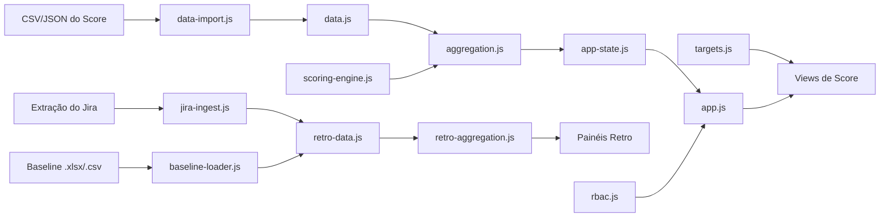

# Funcionamento do Sistema — PEP

Documento técnico que explica, de ponta a ponta, **como a plataforma funciona por dentro**:
os módulos JavaScript e suas responsabilidades, o fluxo de dados (importação → cálculo →
renderização), o estado/persistência e os pontos de extensão. Complementa o `design.md`
(decisões) e o `architecture.md` (visão macro + alvo de produção).

## 1. Natureza da aplicação

- **Estática, sem backend.** HTML/CSS/JS puro, carregado por `<script>` no `index.html`.
  Sem bundler/build. Abre por `file://` ou servidor estático.
- **Módulos IIFE.** Cada arquivo JS é uma IIFE que se registra em `window`/`globalThis`
  (no browser) e em `module.exports` (para os testes em Node). **Não há sistema de import de
  módulos ES** — a ordem das tags `<script>` no `index.html` importa.
- **Bibliotecas via CDN:** Chart.js (gráficos), SheetJS/XLSX (ler baseline `.xlsx`),
  Google Fonts (Inter).

## 2. Mapa de módulos (`aplicacao/js/`)

### Núcleo de cálculo (domínio puro)
| Módulo | Responsabilidade |
|--------|------------------|
| `scoring-engine.js` | Motor de Score: 12 métricas, 4 categorias (Processos/Práticas/Produto/Pessoas), teto 1089, faixas e interpolação, Farol. Expõe `ScoringEngine` (global). |
| `aggregation.js` | Agrega Score: Time → Jornada → Engenharia (média das jornadas). |
| `targets.js` | Metas: ponto de partida, meta %, metas mensais progressivas, Farol de atingimento. |
| `identity.js` | Identidade canônica de Jornada/Squad (fonte única compartilhada por Score e Retro). |
| `rbac.js` | Matriz de permissões por perfil (fonte única). `can`, `homeView`, `menuFor`. |

### Dados e ingestão
| Módulo | Responsabilidade |
|--------|------------------|
| `data.js` | Modelo mensal de Score (seed embutido): registros `(mês, jornada, time, métricas)`. |
| `data-import.js` | Importação manual de CSV/JSON do Score (parse + validação), atualizando o modelo em memória. |
| `retro-data.js` | Dataset da Retrospectiva de PI (PI/Sprint/Time/TipoItem) + API de consulta. |
| `retro-aggregation.js` | Agregações dos painéis da Retro (pontos, produtividade, épicos, cycle/lead time, etc.). |
| `retro-import.js` | Importação de dados da Retro. |
| `retro-filters.js` | Estado dos filtros Jornada/Squad/Sprint/PI (encadeados), persistido. |
| `jira-mapping.js` | Mapeamento de campos da extração do Jira → modelo interno. |
| `jira-ingest.js` | Ingestão da extração do Jira → indicadores por Sprint. |
| `baseline-loader.js` | Carga do baseline de PI (`.csv`/`.xlsx` via SheetJS). |
| `ops-bridge.js` | Ponte Operacional/Times → demais visões (reconciliação de identidade). |

### Estado, persistência e gestão
| Módulo | Responsabilidade |
|--------|------------------|
| `app-state.js` | Estado da sessão: Mês, PI, Perfil e view ativa; *pub/sub* para re-render. Persistência defensiva. |
| `admin-store.js` | CRUD client-side das coleções de gestão (perfis, tribos/squads, integração) + import/export CSV/JSON reversível. |
| `excecoes-store.js` | Store do fluxo de exceção (solicitar/aprovar), com histórico. |

### Apresentação (views) — `aplicacao/js/views/`
- **Score:** `view-geral`, `view-jornadas`, `view-metricas`, `view-evolucao`, `view-metas`,
  `view-exec-squad`, `view-apresentacao`.
- **Retrospectiva de PI:** `retro-pontos`, `retro-produtividade`, `retro-epicos`,
  `retro-cycle-time`, `retro-lead-time`, `retro-debito`, `retro-sustentacao`, `retro-extras`.
- **Gestão:** `admin-perfis`, `admin-tribos-squads`, `admin-integracao`.
- **Exceção:** `view-excecoes`.
- **Legado:** `dashboard.js` (aba Operacional/Times: ranking, filtros, detalhamento, entrada
  manual, export).

Cada view expõe `render(container, { month | pi })`, registra-se em `window.PEPViews` e assina
o `AppState`. O `app.js` orquestra navegação, menu (via RBAC) e dispatch de render.

## 3. Fluxo de dados (ponta a ponta)

1. **Importação:** o usuário carrega CSV/JSON (Score) ou extração do Jira + baseline (Retro).
   Os parsers validam e atualizam os modelos **em memória** (`data.js`/`retro-data.js`).
2. **Cálculo:** `scoring-engine` avalia as métricas → `aggregation` consolida Time→Jornada→
   Engenharia; `targets` calcula metas e Farol.
3. **Estado:** `app-state` guarda Mês/PI/Perfil e notifica os subscribers.
4. **Renderização:** `app.js` chama o `render` da view ativa; a view lê os dados calculados e
   desenha (Chart.js + HTML). As cores dos gráficos seguem o tema (ver `guia-estilo-ui.md`).

## 4. Estado e persistência (localStorage)

A persistência é **defensiva**: se `localStorage` não existir (Node/teste, modo privado),
cai para um store em memória — o app continua funcionando.

| Chave | Conteúdo |
|-------|----------|
| `pep.selectedMonth` | Mês selecionado (1–12) das visões de Score. |
| `pep.selectedPI` | PI selecionado (independente do Mês) da Retrospectiva. |
| `pep.profile` | Perfil ativo (simulação de visibilidade / RBAC client-side). |
| `pep.retroFilters` | Filtros Jornada/Squad/Sprint/PI da Retro. |
| `pep.excecoes` | Solicitações de exceção e seu histórico. |
| `pep.admin.*` | Coleções de gestão (uma chave por coleção). |

> Importante: os **dados de Score/Retro importados** vivem em memória na sessão (seed em
> `data.js`/`retro-data.js` + o que for importado). Para não perder, use o **export CSV/JSON**.
> Mês, PI, Perfil, filtros, exceções e coleções de gestão é que são persistidos no navegador.

## 5. Controle de acesso (RBAC) — simulação

O `rbac.js` é a **fonte única** de permissões. O `app.js` monta o menu e bloqueia telas
conforme `can(profile, screenId)` (nega por omissão). É uma **simulação de visibilidade**
client-side (um banner avisa isso) — **não é segurança real**; autenticação/RBAC server-side
é tema da fase de produção (ver `roadmap-producao.md`).

Perfis: Admin ≡ DM (acesso total), TM (dashboards + produtividade + solicitar exceção), GPM
(4 dashboards), TL (executivo/detalhado por squad + produtividade). Exceção: solicitar
(TM/Admin/DM) → aprovar (Admin/DM). Matriz completa em `design.md`/`glossario.md`.

## 5A. Filtros da Retrospectiva de PI (Jornada/Squad) e granularidade dos dados

Os painéis de Retro recebem do `app.js` o objeto `{ pi, filter }`, onde `filter` vem de
`RetroFilters.getState()` com a sentinela `'all'` para "Todos". Regras importantes:

- **Sentinela `'all'`** é tratada centralmente em `retro-aggregation.js` (`normFilter` /
  `isAll`): valores `'all'`/`null` **não** viram critério de filtro (senão filtrariam por um
  squad/jornada literalmente chamado "all", retornando vazio — esse era o bug original).
- **Propagação de KPIs (Pontos Trabalhados):** `pontosPorSprint` propaga `planejado`, `real`,
  `piPlanning` e `velocidade` da fonte para o painel (preservando `null` como "—"). Sem isso,
  os quatro cartões apareciam vazios mesmo havendo dados.
- **Débito por escopo:** `debitoTecnico` aplica o filtro também ao total consolidado da
  jornada (não só ao backlog por time), para o painel refletir o escopo selecionado.
- **Granularidade por squad:** só a **Situação dos Épicos** tem `squad` real; Pontos e
  Produtividade são por jornada. Quando o filtro é um Squad, Pontos/Produtividade resolvem a
  jornada do squad (via `PEPIdentity.jornadaOf`) e exibem o escopo como "Squad · Jornada".
- **Comparação tolerante de squad:** `PEPRetroData.query` compara `squad` normalizando
  acento/espaço/caixa e aplicando aliases (ex.: "Athenas - Atendimento" ↔ "Atendimento"),
  para que os rótulos do filtro (de `data.js`) casem com os valores das coleções de Retro.

Detalhes de negócio e fontes reais do PI 4/26 em `parametrizacao-metricas-jira.md` (seção 5).

## 6. Pontos de atenção e extensão

- **Ordem dos `<script>`** no `index.html`: um módulo precisa carregar antes de quem o
  consome (ex.: `scoring-engine.js` antes das views). Stores carregam antes das suas views.
- **Exposição global:** todo módulo IIFE deve registrar-se em `globalThis` (e `module.exports`
  para testes). Um módulo declarado só com `const X = (...)()` **não** vira `window.X` — é
  obrigatório o bloco `globalThis.X = X`. (Esse exato descuido já causou o erro "Módulos de
  cálculo indisponíveis" no `scoring-engine.js`, por falta do registro global.)
- **Identidade canônica:** nomes de Jornada/Squad devem ser consistentes entre Score, Jira,
  baseline e gestão; `identity.js` + a tela de Integração ajudam a reconciliar.
- **Adicionar uma view:** crie `js/views/minha-view.js` expondo `render` e registrando em
  `window.PEPViews`; adicione a tag `<script>` no `index.html` (após dependências, antes de
  `app.js`); registre a tela no `rbac.js` (se entrar no menu) e no mapa de telas do `app.js`.

## Documentos relacionados
- `design.md` — decisões e regras de domínio (detalhadas por fase).
- `architecture.md` — arquitetura atual + alvo de produção.
- `data-model.md` / `database-ddl.sql` — modelo de dados e DDL (produção).
- `guia-estilo-ui.md` — tematização e UI. `guia-testes.md` — como testar.
- `MANUAL-DO-USUARIO.md` — uso funcional. `glossario.md` — termos.
