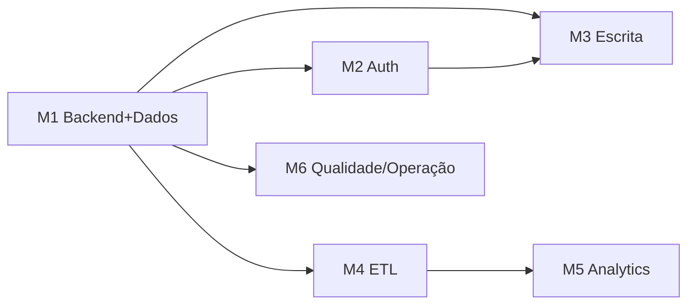

# Roadmap para Produção — PEP

Backlog **acionável e priorizado** para evoluir o MVP estático (Opção B) até um ambiente de
produção corporativo. Complementa o plano conceitual de `architecture.md` (seções 4–6) com
tarefas concretas, agrupadas por marcos.

> Legenda de esforço: P (pequeno), M (médio), G (grande). Prioridade: P0 (crítico) a P3 (desejável).

## Situação atual (baseline)

O MVP já entrega: motor de score reconciliado (4 Ps, teto 1089), 7 visões executivas,
Retrospectiva de PI com filtros, ingestão manual de Jira/baseline, RBAC client-side e telas
de gestão — tudo client-side com persistência em `localStorage` e suíte de testes
(Vitest + fast-check). O que falta é tudo o que depende de **backend, banco, autenticação
real e integrações automáticas**.

## Marco 1 — Fundação de backend e dados (P0)

| # | Tarefa | Esforço | Prioridade |
|---|--------|---------|------------|
| 1.1 | Extrair o domínio puro (score, agregação, metas, RBAC) para um pacote reutilizável no backend | M | P0 |
| 1.2 | Provisionar PostgreSQL e aplicar `database-ddl.sql` em ambiente dev | P | P0 |
| 1.3 | Script de seed a partir dos CSVs atuais (round-trip já existe no MVP) | M | P0 |
| 1.4 | API mínima de leitura dos dashboards (score por squad/jornada, séries mensais) | G | P0 |
| 1.5 | Testes de equivalência API × domínio (reusar oráculo PBT do MVP) | M | P0 |

## Marco 2 — Autenticação e autorização (P0)

| # | Tarefa | Esforço | Prioridade |
|---|--------|---------|------------|
| 2.1 | Login via SSO corporativo (Azure AD / Cogna) | G | P0 |
| 2.2 | RBAC server-side como autoridade; mapear `rbac.PERMISSIONS` para tabelas `Perfil`/`Permissao` | M | P0 |
| 2.3 | Frontend passa a refletir o RBAC do servidor (deixa de decidir) | M | P0 |
| 2.4 | Auditoria de acesso e de ações sensíveis (exceções, gestão) | M | P1 |

## Marco 3 — Migração de escrita (P1)

| # | Tarefa | Esforço | Prioridade |
|---|--------|---------|------------|
| 3.1 | Endpoints CRUD para gestão (usuários, tribos/squads, perfis, integração) | G | P1 |
| 3.2 | Workflow de exceção no servidor (tabela `Excecao` + estados solicitar/aprovar) | M | P1 |
| 3.3 | Manter import/export CSV/JSON como contrato estável (ponte MVP ↔ produção) | P | P1 |
| 3.4 | Migração de dados de `localStorage` dos usuários-piloto (export → import na API) | P | P2 |

## Marco 4 — Integrações automáticas / ETL (P1–P2)

| # | Tarefa | Esforço | Prioridade |
|---|--------|---------|------------|
| 4.1 | Cofre de segredos para credenciais de integração (fora do banco de domínio) | M | P1 |
| 4.2 | ETL do Jira: coleta agendada → indicadores por Sprint/PI (substitui upload manual) | G | P1 |
| 4.3 | Reconciliação de identidade Jira × plataforma (reusar `identity.js`/mapeamento) | M | P1 |
| 4.4 | ETL do ServiceNow (incidentes/SLA) | G | P2 |
| 4.5 | ETL do Datadog (disponibilidade) | M | P2 |
| 4.6 | Painel de saúde das integrações (última coleta, erros, latência) | M | P2 |

## Marco 5 — Analytics avançado (P2–P3)

| # | Tarefa | Esforço | Prioridade |
|---|--------|---------|------------|
| 5.1 | Previsão de indicadores com base no histórico dos times | G | P2 |
| 5.2 | Insights automáticos de melhoria segmentados por time/jornada | G | P2 |
| 5.3 | Flexibilização de regras de medição por time/jornada (configurável) | M | P2 |
| 5.4 | Alertas automáticos (farol/SLA/queda de score) por canal corporativo | M | P3 |

## Marco 6 — Qualidade, operação e governança (P1–P2)

| # | Tarefa | Esforço | Prioridade |
|---|--------|---------|------------|
| 6.1 | Pipeline CI/CD (build, testes, deploy) | M | P1 |
| 6.2 | Observabilidade (logs de ETL e acesso, métricas de uso por perfil) | M | P1 |
| 6.3 | Backup e retenção do banco | P | P1 |
| 6.4 | Testes end-to-end das jornadas de usuário por perfil | M | P2 |
| 6.5 | LGPD: política de retenção/anonimização de dados pessoais (THC, usuários) | M | P2 |

## Dependências entre marcos

## Como os objetivos do projeto se mapeiam no roadmap

| Objetivo | Marco(s) que endereça |
|----------|-----------------------|
| 1. Automatizar o Score, reduzir lançamentos manuais | M4 (ETL) |
| 2. Mais confiabilidade nos indicadores | M1, M4 (fonte única, coleta automática) |
| 3. Monitoramento a qualquer momento e por público | M1, M2 (API + perfis) |
| 4. Previsões com base no histórico | M5.1 |
| 5. Flexibilizar regras por time/jornada | M5.3 |
| 6. Insights de melhoria por time/jornada | M5.2 |
| 7. Otimizar tempo das lideranças | M4, M5 (menos trabalho manual, insights) |
| 8. Criar e acompanhar OKRs | OKRs compõem o Score (categoria Produto); gestão dedicada é evolução futura |

## Riscos
Ver `architecture.md` seção 8 (identidade, perda de dados em `localStorage`, credenciais,
divergência de regra de score). A mitigação-chave é manter o **domínio puro testável** e o
**contrato CSV/JSON** estáveis durante toda a migração.
