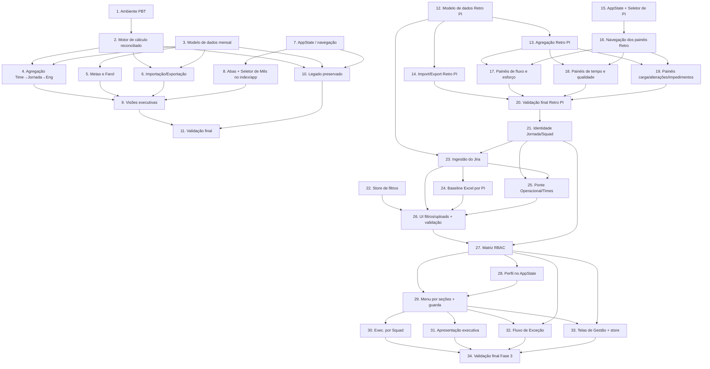

# Implementation Plan

## Overview

Plano incremental para (1) reconciliar o motor de cálculo (`scoring-engine.js`) com a tabela de regras oficial e (2) expandir o MVP com cinco visões executivas mensais, modelo de dados mensal, metas progressivas, Farol e importação/exportação. A ordem prioriza o núcleo puro (motor, agregação, metas) validado por testes de propriedade com `fast-check`, seguido de estado/navegação, visões e preservação do legado. Todas as tarefas mantêm o app estático (sem build/servidor para rodar a aplicação; o runner de testes roda à parte via `npx`).

## Tasks

- [x] 1. Preparar ambiente de testes de propriedade (PBT) sem quebrar o app estático
  - Criar `aplicacao/package.json` com devDependencies `vitest` e `fast-check`, e script `test` usando `vitest --run`.
  - Criar `aplicacao/tests/` e configurar expor os módulos IIFE para teste via guarda de ambiente (`module.exports`/`globalThis`) sem alterar o carregamento por `<script>`.
  - Garantir que o app continua abrindo via `file://` sem build (smoke manual).
  - _Requirements: 9.7_

- [x] 2. Reconciliar o motor de cálculo com a tabela de regras oficial (`scoring-engine.js`)
- [x] 2.1 Introduzir estrutura declarativa `METRIC_RULES`, `CATEGORIES` (4 Ps) e constantes de teto
  - Definir `CATEGORIES` com Processos 450, Práticas 450, Produto 50, Pessoas 50; `MAX_TOTAL_SCORE = 1089`, `BASE_MAX_SCORE = 1000`.
  - Definir `METRIC_RULES` para as 12 métricas conforme o design (faixas, piso/topo, escala e direção), movendo OKRs para `produto` e Team Health Check para escala 0–10.
  - Ajustar `PERFORMANCE_BANDS` para Baixa 0–500, Média 501–839, Boa 840–1000, Ótima 1001–1089.
  - _Requirements: 1.1, 1.2, 1.3, 1.9, 1.11_

- [x] 2.2 Implementar `interpolate` proporcional e `evaluateMetric` genérico
  - Implementar `interpolate(value, from, to, floor, top)` com clamp em `[min(floor,top), max(floor,top)]`.
  - Implementar `evaluateMetric(metricId, value)` percorrendo as faixas da regra, tratando direção `higher`/`lower`/`category` e escalas (`ratio`, `days`, `thc0a10`, `category`).
  - Tratar valor `null`/`undefined`/`NaN` como `band:'sem-dados'`, `label:'Sem Dados'`, distinto de `nao-atendeu`.
  - _Requirements: 1.4, 1.5, 1.6, 1.8, 1.10_

- [x] 2.3 Reescrever `calculateTeamScore` e `getPerformanceBand` sobre o avaliador genérico
  - Somar as 12 métricas, consolidar `categoryScores` nas 4 categorias e classificar a Faixa de Performance.
  - Manter a interface pública compatível com o legado onde possível (expor `METRIC_RULES`, `CATEGORIES`, `evaluateMetric`, `interpolate`).
  - _Requirements: 1.7, 1.9_

- [x] 2.4 Testes de propriedade do motor de cálculo
  - Criar oráculo independente das faixas (ou vetores extraídos da planilha) e comparar motor × oráculo dentro de 0,01 (Property 1).
  - Interpolação nunca sai da faixa (Property 2); monotonicidade por direção (Property 3).
  - Score total = soma e dentro de [0,1089], ≤1000 sem Superou (Property 4); SLA sem Superou (Property 5); faixas de performance exclusivas (Property 6).
  - Incluir geradores com limites de faixa e `null`; mínimo de 100 execuções por teste.
  - _Requirements: 1.4, 1.5, 1.6, 1.7, 1.8, 1.9, 1.11, 1.12_

- [x] 2.5 Testes de exemplo da configuração do motor
  - Verificar soma de pesos por categoria (450/450/50/50), OKRs em Produto e teto 1089.
  - Verificar "Sem Dados" distinto de "Não atendeu" para cada métrica.
  - _Requirements: 1.1, 1.2, 1.3, 1.10_

- [x] 3. Migrar o modelo de dados de snapshot único para modelo mensal (`data.js`)
- [x] 3.1 Reestruturar `data.js` para registros mensais `(mês, jornada, time, métricas)`
  - Definir `Dataset` com `year`, `jornadas`, `records` (esparso) e `source` (`current:'planilha-manual'`, `futurePlanned:['ServiceNow','Datadog']`).
  - Converter os times/métricas existentes para registros mensais; expressar Team Health Check em escala 0–10.
  - Expor API de consulta por mês/jornada/time.
  - _Requirements: 8.1, 8.2, 8.6_

- [x] 3.2 Definir baseline dez/25 (Partida) por jornada
  - Criar `Baseline` com o score realizado de dez/2025 por jornada, para uso em Metas.
  - _Requirements: 7.1_

- [x] 4. Implementar agregação Time → Jornada → Engenharia (`aggregation.js`)
- [x] 4.1 Implementar `journeyScore` e `engineeringScore` por mês
  - Score da Jornada = média dos scores dos Times com dado; Score de Engenharia = média dos scores das Jornadas.
  - Consolidar `categoryScores` e `performanceBand` em cada nível; ignorar times/jornadas sem dado.
  - _Requirements: 3.1, 4.1_

- [x] 4.2 Implementar `monthDelta` e `highlights`
  - `monthDelta` retorna `null` quando não há mês anterior com dados.
  - `highlights` retorna maior alta e maior queda vs mês anterior; vazios quando sem mês anterior.
  - _Requirements: 3.6, 4.4, 3.8_

- [x] 4.3 Implementar média de métrica por jornada e distribuição por faixa
  - Média por métrica ignorando "Sem Dados".
  - Contagem de times por Faixa de Atendimento (Não atendeu, Parcial, Atendeu, Superou).
  - _Requirements: 5.3, 5.4_

- [x] 4.4 Testes de propriedade da agregação
  - Médias em dois níveis (Property 7); destaques de alta/queda (Property 10).
  - Média por métrica ignora Sem Dados (Property 11); distribuição por faixa é completa (Property 12).
  - _Requirements: 3.1, 4.1, 3.6, 4.4, 3.8, 5.3, 5.4_

- [x] 5. Implementar metas progressivas e Farol (`targets.js`)
- [x] 5.1 Implementar cálculo de metas por jornada
  - `META_PCT` com Secretaria e Gestor de Unidades = 0,145 e `_default` = 0,05.
  - `partida`, `meta2026`, `metaMes`, `acrescimoMensal`, `atingimento`.
  - Tratar `metaMes = 0` retornando atingimento indisponível (sem NaN/Infinity).
  - _Requirements: 7.1, 7.2, 7.3, 7.4, 7.6, 7.7_

- [x] 5.2 Implementar `farol` como fonte única
  - `farol(at)`: Na meta ≥ 0,99; Atenção ≥ 0,80 e < 0,99; Crítico < 0,80.
  - _Requirements: 2.3, 4.3, 6.3, 7.5_

- [x] 5.3 Testes de propriedade de metas e Farol
  - Meta 2026 derivada (Property 13); progressão linear da Meta do Mês (Property 14); atingimento = realizado/meta (Property 15).
  - Classificação do Farol (Property 8); particionamento das contagens por Farol (Property 9).
  - _Requirements: 7.2, 7.3, 7.4, 7.5, 7.6, 7.7, 2.3, 3.4, 3.5, 4.3, 6.3_

- [x] 6. Implementar importação/exportação de dados (`data-import.js`)
- [x] 6.1 Implementar parser e validação
  - `parseCSV` (separador `;`, UTF-8/BOM, decimais com vírgula ou ponto) e `parseJSON`.
  - `validateRecord` exigindo mês, jornada, time e valores de métrica; domínios válidos.
  - `importText` acumulando `rejected[]` com mensagens descritivas e importando os válidos.
  - _Requirements: 8.3, 8.4, 8.5_

- [x] 6.2 Implementar exportação reversível `toCSV`
  - Gerar CSV com `;` e BOM; cabeçalho conforme o design.
  - _Requirements: 8.7, 9.5_

- [x] 6.3 Testes de propriedade e exemplo de importação
  - Round-trip `parseCSV(toCSV(ds))` equivalente dentro de 0,01 (Property 16).
  - Exemplos: registro incompleto rejeitado com mensagem; CSV inicia com BOM e usa `;`.
  - _Requirements: 8.4, 8.5, 8.7, 9.5_

- [x] 7. Implementar estado da aplicação e navegação (`app-state.js`)
- [x] 7.1 Implementar `AppState` com mês persistente e view ativa
  - `getSelectedMonth`/`setSelectedMonth` com `localStorage` (default = último mês com dados) e `subscribe` para re-render.
  - `getActiveView`/`setActiveView` mantendo o mês ao trocar de visão.
  - _Requirements: 2.1, 2.2, 2.5_

- [x] 7.2 Teste de propriedade de persistência do mês
  - Navegação entre visões mantém o Mês Selecionado inalterado (Property 17).
  - _Requirements: 2.5_

- [x] 8. Construir navegação por abas e Seletor de Mês no `index.html` + `app.js`
  - Adicionar toolbar com Seletor de Mês (Jan–Dez) acessível em todas as visões e containers das 5 visões + aba do legado.
  - Fazer `app.js` inicializar o `AppState`, montar as abas e disparar o render da visão ativa ao trocar mês/aba.
  - _Requirements: 2.1, 2.2, 2.4_

- [x] 9. Implementar as visões executivas (`js/views/*.js`)
- [x] 9.1 Visão Geral (`view-geral.js`)
  - Gauge 0–1000 do score de Engenharia, rótulo de faixa, % de atingimento da meta do mês.
  - Contagem de jornadas por Farol, destaques maior alta/queda, donut das 4 categorias.
  - No primeiro mês com dados, exibir apenas os indicadores numéricos de variação como indisponíveis; destaques ficam vazios.
  - _Requirements: 3.1, 3.2, 3.3, 3.4, 3.5, 3.6, 3.7, 3.8_

- [x] 9.2 Visão de Jornadas (`view-jornadas.js`)
  - Card por jornada com gauge, faixa, % meta vs realizado, Farol, delta vs mês anterior e "X de Y pontos" por categoria.
  - Indicar visualmente ausência de dado da jornada no mês.
  - _Requirements: 2.3, 4.1, 4.2, 4.3, 4.4, 4.5_

- [x] 9.3 Visão de Métricas por Jornada (`view-metricas.js`)
  - Seleção de jornada → 12 métricas agrupadas pelas 4 categorias, com gauge, "pontos de máximo" e rótulo de faixa.
  - Média dos times por métrica e distribuição de times por faixa.
  - _Requirements: 5.1, 5.2, 5.3, 5.4_

- [x] 9.4 Evolução Mensal (`view-evolucao.js`)
  - Tabela Jan–Dez × (jornadas + Engenharia); células coloridas por Farol `realizado ÷ meta do mês`; cinza quando sem dado.
  - Alternância "Score realizado" / "% da meta".
  - _Requirements: 6.1, 6.2, 6.3, 6.4, 6.5_

- [x] 9.5 Visão de Metas (`view-metas.js`)
  - Tabela Jornada · Partida dez/25 · Meta % · Meta 2026 · acréscimo/mês · metas Jan–Dez, com Farol por jornada no mês selecionado.
  - _Requirements: 7.1, 7.2, 7.3, 7.4, 7.5, 7.6, 7.7_

- [x] 9.6 Testes de integração/UI das visões (exemplos representativos)
  - Seletor de Mês presente nas 5 visões; troca de mês re-renderiza todas.
  - Cada visão renderiza os elementos esperados com dataset conhecido; render isolado por try/catch.
  - _Requirements: 2.1, 2.2, 2.4, 3, 4, 5, 6, 7_

- [x] 10. Preservar o dashboard legado como aba "Operacional/Times" (`dashboard.js`)
  - Preservar ranking de times, filtros por jornada/time, detalhamento por métrica (modal), entrada manual e exportação CSV (`;` + BOM).
  - Ajustar para ler o mês do `AppState` e usar as 4 categorias corrigidas; preservar tema da plataforma/UX.
  - Teste de regressão: ranking por score desc, filtros, modal com 12 métricas, entrada manual atualiza score; smoke `file://`.
  - _Requirements: 9.1, 9.2, 9.3, 9.4, 9.5, 9.6, 9.7_

- [x] 11. Validação final de equivalência e verificação completa
  - Rodar toda a suíte (`vitest --run`) e confirmar as 17 propriedades e os testes de exemplo.
  - Validar a equivalência do motor com a planilha de Score (oráculo) e confirmar o app abrindo sem build/servidor.
  - _Requirements: 1.12, 9.7_

- [x] 12. Modelo de dados de Retrospectiva de PI (`retro-data.js`)
  - Criar `RetroDataset` por PI/Sprint/Time/Tipo de Item conforme o design (pontosTrabalhados, produtividade, epicos, cycleTime, leadTime, debito, sustentacao, cargaTrabalho, alteracoesPlano, impedimentos), independente do modelo mensal do Score.
  - Popular com vetores de exemplo extraídos da planilha "03 - Cogna - Template Métricas Review - Retro PI"; registrar `source` (planilha-manual-jira / futuro: Jira).
  - Expor API de consulta por PI/Time e a lista de PIs disponíveis.
  - _Requirements: 18.1, 18.5, 18.7_

- [x] 13. Agregação de Retrospectiva de PI (`retro-aggregation.js`)
- [x] 13.1 Implementar agregações de pontos, produtividade e épicos
  - `pontosPorSprint` (Entrega de Valor + Sustentação = total; percentuais), `produtividadePorPI` (média da Jornada ignorando sem dado) e `situacaoEpicos` (partição nas 6 situações por origem).
  - _Requirements: 10.1, 10.2, 11.1, 11.2, 12.1, 12.4_
- [x] 13.2 Implementar agregações de cycle/lead time, débito e sustentação
  - `cycleTimePorFase` e `leadTimePorTipo` (média da Jornada), `debitoTecnico` (consistência Pendente e totais) e `sustentacao` (totais + histórico).
  - _Requirements: 13.2, 14.2, 15.2, 15.3, 16.1, 16.2_
- [x] 13.3 Testes de propriedade das agregações de Retro PI
  - Properties 18–23 (composição de pontos, média de produtividade, partição de épicos, médias de cycle/lead time, consistência do débito, totais de sustentação), ≥100 execuções.
  - _Requirements: 10.1, 10.2, 11.1, 11.2, 12.1, 12.4, 13.2, 14.2, 15.2, 15.3, 16.1, 16.2_

- [x] 14. Importação/exportação de Retrospectiva de PI (`retro-import.js`)
  - `parseCSV` (`;`+BOM, decimais vírgula/ponto) e `parseJSON`; `validateRecord` por tipo de registro (mínimo PI, Time e indicador); `toCSV` reversível.
  - Teste de propriedade do round-trip (Property 24) e exemplos de rejeição com mensagem.
  - _Requirements: 18.2, 18.3, 18.4, 18.6_

- [x] 15. Estender AppState com Seletor de PI independente (`app-state.js`)
  - `getSelectedPI`/`setSelectedPI` persistido em chave própria no `localStorage`; lista `RETRO_VIEWS`; não alterar o Mês Selecionado ao mudar o PI.
  - Teste de propriedade da independência Seletor de PI × Seletor de Mês (Property 25).
  - _Requirements: 18.7, 19.3_

- [x] 16. Navegação dos painéis de Retro PI no `index.html` + `app.js`
  - Adicionar aba agrupadora "Retrospectiva de PI" com sub-abas dos painéis e o Seletor de PI (independente do Seletor de Mês); registrar as views em `window.PEPViews` e disparar render ao trocar PI/aba.
  - _Requirements: 18.7, 19.3_

- [x] 17. Painéis de fluxo e esforço (`js/views/retro-*.js`)
- [x] 17.1 Painel de Pontos Trabalhados (`retro-pontos.js`)
  - Barras empilhadas por Sprint (Entrega de Valor vs Sustentação), total e %, indicadores Planejado/Real/PI Planning/Velocidade; ausência de dado em cinza.
  - _Requirements: 10.1, 10.2, 10.3, 10.4, 10.5_
- [x] 17.2 Painel de Produtividade (`retro-produtividade.js`)
  - Produtividade por Time por PI + média da Jornada; alternância PI vigente/histórico; ausência de dado indicada.
  - _Requirements: 11.1, 11.2, 11.3, 11.4_
- [x] 17.3 Painel de Situação dos Épicos (`retro-epicos.js`)
  - Contagem nas 6 situações (Baseline vs Mudança de Escopo); listagem de épicos por situação selecionada.
  - _Requirements: 12.1, 12.2, 12.3, 12.4_

- [x] 18. Painéis de tempo e qualidade (`js/views/retro-*.js`)
- [x] 18.1 Painel de Cycle Time por fase (`retro-cycle-time.js`)
  - Tempo médio por fase (Ideação/Dev/Homologação/Implantação) por Time + média da Jornada; filtro por Tipo de Item e Status; ausência de dado indicada.
  - _Requirements: 13.1, 13.2, 13.3, 13.4_
- [x] 18.2 Painel de Lead Time por Tipo de Item (`retro-lead-time.js`)
  - Lead Time por Squad e Tipo de Item + média da Jornada; ausência de dado indicada.
  - _Requirements: 14.1, 14.2, 14.3_
- [x] 18.3 Painel de Débito Técnico (`retro-debito.js`)
  - Backlog por Time e Planejado/Real/Entregue/Pendente/Cancelado (SP e quantidade) + total da Jornada.
  - _Requirements: 15.1, 15.2, 15.3_
- [x] 18.4 Painel de Sustentação (`retro-sustentacao.js`)
  - Incidentes + Solicitações Realizado vs Planejado por Time + total da Jornada; histórico por PI com %.
  - _Requirements: 16.1, 16.2, 16.3_

- [x] 19. Painéis de carga, alterações e impedimentos (`retro-extras.js`)
  - Carga de Trabalho por Tipo de Item (pontos, %pontos, qtde, %itens, pontuação média); Alterações no Plano (Baseline/PI Planning/Mudança de Escopo/Cancelado/Transbordo em Épicos/Histórias/Pontos); Impedimentos (quantidade, localização, tempo de remoção) por PI e Sprint; ausência de dado indicada.
  - Testes de integração/UI representativos dos painéis de Retro PI (presença do Seletor de PI, render com dataset conhecido, ausência de dado, render isolado).
  - _Requirements: 17.1, 17.2, 17.3, 17.4, 19.1_

- [x] 20. Validação final do módulo de Retro PI
  - Rodar a suíte completa e confirmar as Properties 18–25 e os testes de exemplo (oráculo da planilha de Retro PI).
  - Confirmar o app estático (file://) e a independência Seletor de PI × Seletor de Mês, sem regressão no módulo de Score.
  - _Requirements: 18.6, 19.2, 19.3, 19.4_

- [x] 21. Identificação canônica de Jornada/Squad compartilhada (`identity.js`)
  - Criar um mapa único de Jornada↔Squad reutilizado por Retro PI e Operacional/Times, garantindo identificação idêntica nos dois módulos.
  - Expor funções de normalização/consulta (squad→jornada, lista de squads por jornada) e detecção de divergência.
  - Teste de propriedade da consistência de identificação entre módulos (Property 30).
  - _Requirements: 23.1, 23.5_

- [x] 22. Store de filtros Jornada/Squad/Sprint/PI (`retro-filters.js`)
  - Store observável do estado `{ pi, jornada, squad, sprint }` com encadeamento Jornada→Squad e PI→Sprint, opção "Todos" (agrega) e persistência em `localStorage`.
  - Teste de propriedade do encadeamento e agregação dos filtros (Property 26).
  - _Requirements: 20.1, 20.2, 20.3, 20.5, 20.7_

- [x] 23. Ingestão de extração do Jira e derivação por Sprint (`jira-ingest.js`)
- [x] 23.1 Parser e validação da extração do Jira
  - `parseJira` (CSV/JSON) normalizando itens `{ chave, tipo, status, sprint, pi, squad, jornada, pontos, datas }`; `validateItem` com rejeição descritiva dos inválidos.
  - _Requirements: 21.1, 21.3, 21.5, 21.6_
- [x] 23.2 Derivação dos indicadores por Sprint a partir dos itens
  - Derivar pontos trabalhados, cycle/lead time, situação de épicos, débito, sustentação, carga e impedimentos para o `RetroDataset`.
  - Teste de propriedade da conservação de pontos na derivação (Property 27).
  - _Requirements: 21.2, 21.4_
- [x] 23.3 Exportação reversível dos dados derivados
  - `toCSV` dos derivados; teste de propriedade do round-trip (Property 28).
  - _Requirements: 21.7_

- [x] 24. Carga do Excel de baseline por PI (`baseline-loader.js`)
  - Leitura do `.xlsx` no navegador (SheetJS), associação ao PI, substituição por novo upload, rejeição de arquivo inválido com mensagem e indicação de presença de baseline por PI.
  - Uso do baseline como referência de Baseline vs Mudança de Escopo e Situação dos Épicos.
  - Teste de propriedade da associação de baseline ao PI correto (Property 29).
  - _Requirements: 22.1, 22.2, 22.3, 22.4, 22.5, 22.6_

- [x] 25. Ponte com o Operacional/Times e fluxo de dados (`ops-bridge.js`)
  - Mapear indicadores derivados do Jira que correspondem a métricas do Score (ex.: Cycle Time, Frequência de Deploy) para entradas do Operacional/Times usando a identificação canônica.
  - Garantir que o Operacional/Times alimente as visões de Score e que atualizações se reflitam; sinalizar divergência de identificação sem corromper dados.
  - _Requirements: 23.2, 23.3, 23.4, 23.5_

- [x] 26. UI dos filtros, uploads e validação final da extensão
  - Adicionar na aba de Retrospectiva de PI os controles de filtro (Jornada/Squad/Sprint/PI), o campo de upload da extração do Jira e o campo de upload do Excel de baseline; ligar os painéis ao `retro-filters` e indicar ausência de dado por combinação de filtros (tema da plataforma preservado).
  - Testes de integração/UI (filtros encadeados re-renderizam, uploads processam no navegador, indicação de baseline por PI) e smoke estático (file://, sem chamadas externas).
  - Rodar a suíte completa e confirmar as Properties 26–30 sem regressão nos módulos de Score e Retro PI.
  - Nota (manutenção pós-MVP): o Sprint foi removido da toolbar de Retro; os filtros ativos são Jornada e Squad. Os filtros passaram a funcionar de fato nos painéis após correções (ver seção "Manutenção pós-MVP").
  - _Requirements: 20.4, 20.6, 22.1, 24.1, 24.2, 24.3, 24.4_

- [x] 27. Matriz de permissões e RBAC (`rbac.js`)
  - Implementar a tabela declarativa `PERMISSIONS` (Perfil × Tela) e as permissões de ação de exceção (`excecao:solicitar`, `excecao:aprovar`), conforme a matriz validada (Admin ≡ DM; TM com dashboards/produtividade e solicitar exceção; TL com executivo por squad, detalhado por jornada/squad e produtividade; GPM sem produtividade/gestão). Nota: os módulos de Gestão de Usuários, Gestão de OKRs, Gestão de KPIs e Configuração de Comunicação foram removidos do produto.
  - Expor `can(profile, screenId)` (nega por omissão), `homeView(profile)` e `menuFor(profile)` como fonte única.
  - Testes de propriedade: nega por omissão (Property 32), menu reflete a matriz (Property 33), home sempre permitida (Property 34). Teste de exemplo da matriz por perfil (oráculo = tabela do descritivo).
  - _Requirements: 27.1, 27.2, 27.3, 27.4, 27.5, 27.6, 27.7, 27.8_

- [x] 28. Perfil no estado da aplicação (`app-state.js`)
  - `getProfile`/`setProfile` persistido em `pep.profile`; default = Administrador; independente de Mês e PI; dispara re-render ao mudar.
  - Teste de propriedade: trocar o Perfil não altera Mês nem PI (Property 36).
  - _Requirements: 25.1, 25.2, 25.7_

- [x] 29. Menu por seções + Seletor de Perfil + guarda de acesso (`index.html` + `app.js`)
  - Substituir a barra de abas plana por um menu com duas seções (Dashboards e Configurações / Gestão e Configuração), renderizado a partir de `rbac.menuFor(profile)`; adicionar o Seletor de Perfil e o banner "simulação de visibilidade (sem autenticação)".
  - Aplicar a tela inicial por perfil (`rbac.homeView`) e a guarda de acesso: tentar abrir tela negada redireciona para a home e sinaliza.
  - Testes de integração/UI: menu mostra só o permitido por perfil; trocar perfil re-renderiza menu e tela; acesso a tela negada redireciona (Property 35); banner presente.
  - _Requirements: 25.3, 25.4, 25.5, 25.6, 26.1, 26.2, 26.3, 26.4, 26.5_

- [x] 30. Dashboard Executivo por Squad (`js/views/view-exec-squad.js`)
  - Score do squad com a régua de Faixas, seletor de squad (identidade canônica), detalhamento por categoria (4 Ps) e Farol no período; ausência de dado indicada; home do perfil TL.
  - Teste de integração/UI com dataset conhecido.
  - _Requirements: 28.1, 28.2, 28.3, 28.4_

- [x] 31. Dashboard de Apresentação Executiva (`js/views/view-apresentacao.js`)
  - Visão por jornada em layout de apresentação (score, faixa, atingimento, destaques), navegação sequencial entre jornadas, reutilizando dados do Operacional/Times; tema da plataforma.
  - Teste de integração/UI representativo.
  - _Requirements: 29.1, 29.2, 29.3, 29.4_

- [x] 32. Fluxo de Exceção com aprovação (`js/views/view-excecoes.js` + store)
  - Solicitação de exceção (TM/Admin/DM) com Squad, indicador, justificativa e período; estado "Pendente"; fila de aprovação para Admin/DM com aprovar/rejeitar (motivo); sinalização do indicador afetado só quando "Aprovada"; histórico e persistência em `localStorage`.
  - Respeitar as permissões de ação (`excecao:solicitar` / `excecao:aprovar`) do RBAC.
  - Testes de integração/UI: solicitação cria pendência; aprovação aplica efeito e rejeição não; validação de campos obrigatórios; TM não vê botão aprovar.
  - _Requirements: 30.1, 30.2, 30.3, 30.4, 30.5, 30.6, 30.7, 30.8, 30.9, 30.10_

- [x] 33. Telas de Gestão (CRUD client-side) e store (`admin-store.js` + `js/views/admin-*.js`)
- [x] 33.1 Store de gestão (`admin-store.js`)
  - CRUD client-side (localStorage) das coleções: perfis, tribos/squads, integração; import/export CSV/JSON reversível.
  - Teste de propriedade do round-trip das coleções (Property 37).
  - _Requirements: 31.4_
  - Nota de evolução: as coleções/telas de usuários, KPIs, OKRs e comunicação foram removidas do produto.
- [x] 33.2 Telas de gestão por coleção (`admin-perfis`, `admin-tribos-squads`, `admin-integracao`)
  - Views de CRUD respeitando a Matriz de Permissões (ocultar/negar quando o perfil não tem acesso); tribos/squads consistentes com a identidade canônica; integração sem armazenar credenciais sensíveis.
  - Testes de integração/UI representativos (ex.: telas de gestão exclusivas de Admin/DM).
  - _Requirements: 31.1, 31.2, 31.3, 31.5_

- [x] 34. Validação final da Fase 3 (perfis, menu, gestão)
  - Rodar a suíte completa e confirmar as Properties 32–37 e os testes de exemplo da matriz; confirmar o app estático (file://) e nenhuma regressão nas fases anteriores.
  - _Requirements: 25.6, 27.7, 31.9_

## Task Dependency Graph



```json
{
  "waves": [
    { "wave": 1, "tasks": ["1"] },
    { "wave": 2, "tasks": ["2", "3", "7"] },
    { "wave": 3, "tasks": ["4", "5", "6", "8"] },
    { "wave": 4, "tasks": ["9", "10"] },
    { "wave": 5, "tasks": ["11"] },
    { "wave": 6, "tasks": ["12", "15"] },
    { "wave": 7, "tasks": ["13", "14", "16"] },
    { "wave": 8, "tasks": ["17", "18", "19"] },
    { "wave": 9, "tasks": ["20"] },
    { "wave": 10, "tasks": ["21", "22"] },
    { "wave": 11, "tasks": ["23"] },
    { "wave": 12, "tasks": ["24", "25"] },
    { "wave": 13, "tasks": ["26"] },
    { "wave": 14, "tasks": ["27"] },
    { "wave": 15, "tasks": ["28"] },
    { "wave": 16, "tasks": ["29"] },
    { "wave": 17, "tasks": ["30", "31", "32", "33"] },
    { "wave": 18, "tasks": ["34"] }
  ]
}
```

## Notes

- Testes de propriedade usam `fast-check` + Vitest (não implementar PBT do zero), mínimo de 100 execuções por propriedade, executados com `vitest --run`.
- Cada teste de propriedade deve referenciar o design: `// Feature: score-performance-executivo, Property {N}: {texto}`.
- A equivalência com a planilha de Score (Property 1) usa um oráculo independente das faixas ou vetores extraídos da planilha, comparando dentro de 0,01.
- Renderização de gráficos, layout e identidade visual são verificados por testes de exemplo/smoke, não por PBT.
- Tarefas 2 e 3 são independentes entre si e podem ser abordadas em paralelo após a 1; a 4 depende de ambas.

## Manutenção pós-MVP (carga real do PI 4/26 e correções de filtro)

Ajustes feitos após a entrega do MVP, sobre o seed e os agregadores da Retrospectiva de PI.
Toda a suíte seguiu verde (440 testes / 46 arquivos). Ver ADR 0006 e
`parametrizacao-metricas-jira.md` (seção 5).

- [x] M1. Carga real do PI 4/26 no seed (`retro-data.js`)
  - Épicos (235, do Jira) → 6 situações via `status.category`; Débito Técnico e Carga de
    Trabalho (contagens reais do Jira); Pontos Trabalhados (Velocity).
  - Coleções sem fonte (Cycle/Lead/Sustentação/Alterações/Impedimentos) ficam "Sem dados"
    honesto; PIs anteriores preservados.

- [x] M2. Planejado e PI Planning do baseline (`Baseline_Jornadas_26.4.xlsx`)
  - Soma de Story Points dos itens do PI por jornada, injetada em `pontosTrabalhados`
    (`planejado`/`piPlanning`). PI Planning = Planejado (baseline é a foto única do plano).

- [x] M3. Correções de filtro dos painéis de Retro
  - `normFilter`/`isAll`: sentinela `'all'` deixa de virar critério (bug de filtro vazio).
  - `pontosPorSprint`: propaga `planejado/real/piPlanning/velocidade` (KPIs vinham vazios).
  - `debitoTecnico`: aplica o filtro de jornada/squad também ao total consolidado.
  - `retro-produtividade.js`: passa a respeitar jornada/squad (antes ignorava o filtro).
  - `PEPRetroData.query`: comparação de squad tolerante (acento/espaço/caixa + aliases),
    reconciliando os rótulos do filtro (`data.js`) com os valores das coleções de Retro.

- [x] M4. Granularidade de squad documentada
  - Só a Situação dos Épicos tem dado por squad; Pontos e Produtividade são por jornada e,
    sob filtro de squad, exibem a jornada do squad com rótulo "Squad · Jornada" (sem fabricar
    número por squad).
